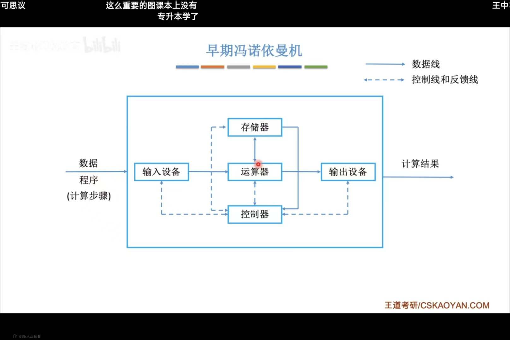
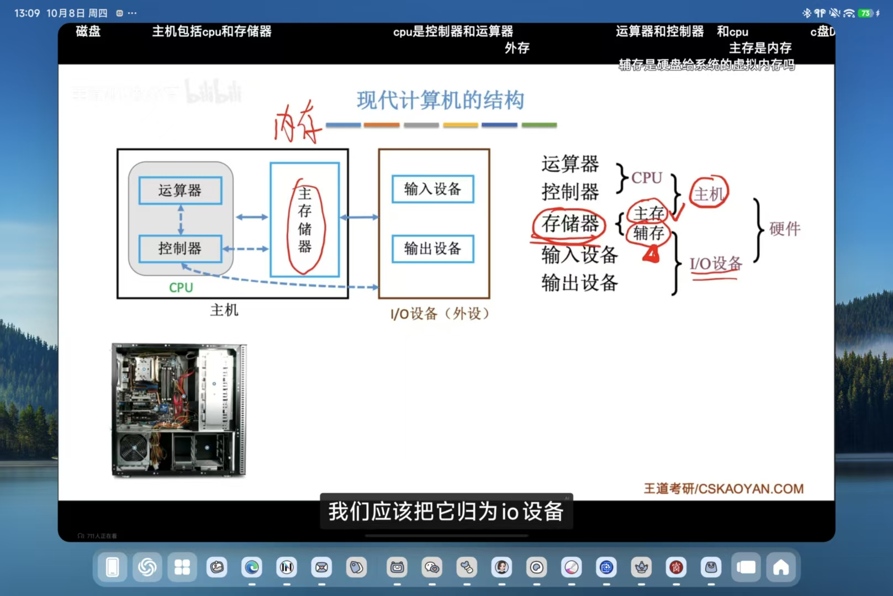
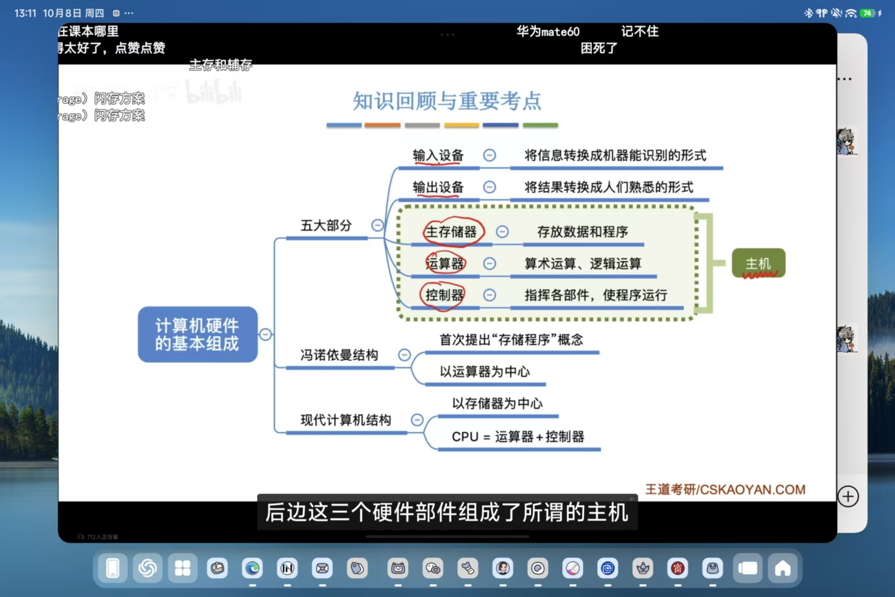
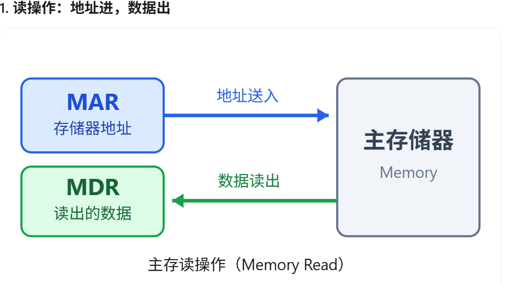
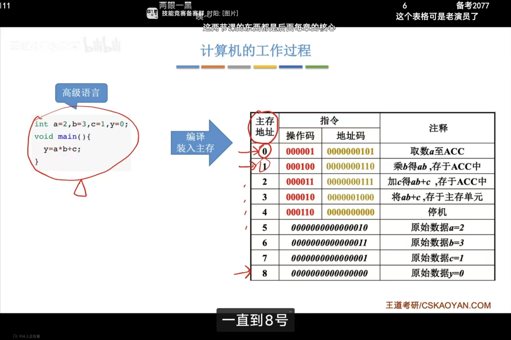
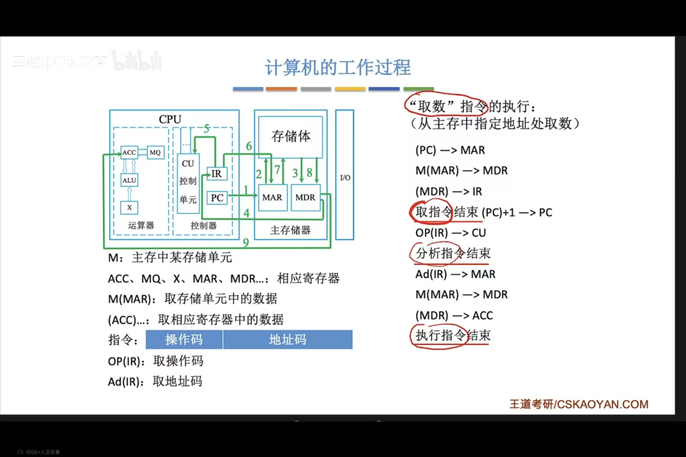
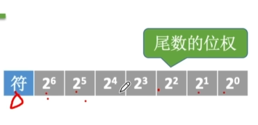
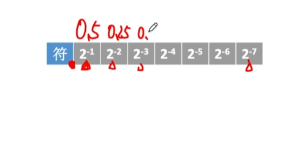

# 第一章 计算机系统概述

### 什么是计算机系统

计算机系统 = 硬件 + 软件

软件：
**系统软件**：用来管理整个计算机系统
**应用软件**：按任务需要编制成各种程序

## 计算机硬件的基本组成

### 早期冯诺依曼结构

**存储程序**：指将指令以二进制代码的形式事先输入计算机的主存储器，然后按其在存储器的首地址执行程序的第一条指令，以后就按该程序的规定顺序执行其它指令，直至程序执行结束



输入设备：将信息转换成机器能够识别的形式

存储器：存放数据和程序
运算器：算术运算/逻辑运算
控制器：指挥程序运行

输出设备：将结果转换为人们熟知的形式

在计算机系统中，软件和硬件在逻辑上是等效的
eg：对于乘法运算，可以设计一个专门的硬件电路来实现乘法运算，**也可以用软件的方式执行多次加法运算来实现**

特点:
    1.计算机由五大部件组成（输入/输出 统称为I/O设备）
    2.指令和数据以同等地位存于存储器，可按地址寻访
    3.指令和数据用二进制表示
    4.指令由操作码和地址码组成
    5.存储程序
    6.**以运算器为中心** （输入/输出设备与存储器之间的数据传输通过运算器完成）

现代计算机：**以存储器为中心**
cpu=运算器+控制器

现代计算机结构

运算器          主存            输入设备
                储
控制器          器              输出设备
cpu      主机



总结


## 各硬件的工作原理
### 主存储器的基本组成

主存储器
    存储体：数据在存储体内按地址存储
        存储单元：每个存储单元存放一串二进制代码（每个地址对应一个存储单元）
        存储字(word):存储单元中的二进制代码的组合
        存储字长：存储单元中的二进制代码的位数(一般是 8bit的整数倍)
        存储元：即存储二进制的电子元件，每个存储元可存储1bit
    MAR(存储地址寄存器)：MAR位数反映了存储单元的个数
    MDR(存储数据寄存器)：MDR位数=存储字长

    eg：MAR=4位->总共有2^4个存储单元
        MDR=16位->每个存储单元可存放16bit 一个字=16bit


### 运算器的基本组成

运算器：用于实现算数运算、逻辑运算
    ACC：累加器，用于存放操作数，或运算结果
    MQ：乘商寄存器，在乘，除运算时，用于存放操作数或运算结果
    X：通用的操作数寄存器，用于存放操作数
    **ALU**：算数逻辑单元，通过内部复杂的电路实现算数运算、逻辑运算

### 控制器的基本组成
控制器：
    **CU**：控制单元，分析指令，给出控制信号
    IR：指令寄存器，存放存放当前执行的指令
    PC：程序计数器，存放下一条指令地址，有自动加1功能

完成一条指令： 
    取指令 PC   
    分析指令 IR   取指
    执行指令 CU   执行

### 计算机的工作过程

高级语言->编译装入主存

```text
来自chatgpt的解释
计算机采用存储程序原理：程序的指令和数据事先存放在主存储器中，CPU 按照指令规定的顺序逐条取出并执行。

基本过程：

编译与装入：高级语言编写的程序经过编译等处理，形成可执行程序，并装入主存。

取指令（Fetch）：CPU 根据 PC 提供的地址，从主存取出指令。

译码（Decode）：CU 分析指令，确定需要执行的操作。

执行（Execute）：CPU 根据指令完成数据读取、算术运算或数据写入等操作。

循环执行：不断取出下一条指令，直到程序结束。

核心：计算机的工作过程就是不断取指令、分析指令、执行指令的过程。

二、CPU 主要硬件及其作用

硬件

英文名称

主要功能

PC

Program Counter

程序计数器，保存下一条待取指令的地址

MAR

Memory Address Register

存储器地址寄存器，保存当前访问的主存地址

MDR

Memory Data Register

存储器数据寄存器，暂存主存读出或待写入的数据

IR

Instruction Register

指令寄存器，保存当前正在执行的指令

CU

Control Unit

控制单元，对指令进行译码并发出控制信号

ACC

Accumulator

累加器，保存操作数或运算结果

ALU

Arithmetic Logic Unit

算术逻辑单元，完成算术和逻辑运算

1. PC 与 MAR 的区别

PC：保存下一条待取指令的地址。

MAR：保存当前访问主存时使用的地址。

注意：PC 只负责指令地址的跟踪，而 MAR 既可以保存指令地址，也可以保存操作数地址。

2. MAR 与 MDR 的区别

MAR：告诉主存访问哪里。

MDR：负责暂存正在交换的数据。

主存读操作：

MAR 提供地址 → 主存读取数据 → MDR 暂存数据

主存写操作：

MAR 提供地址 → MDR 提供待写数据 → 主存完成写入

三、机器指令的基本组成

一条典型的机器指令由两部分组成：

组成部分

功能

操作码（OP）

指明执行什么操作

地址码（Ad）

指明操作数地址等信息

例如：

操作码：000001

地址码：0000000101

在本例教学模型中：

操作码 000001 表示取数操作。

地址码 0000000101 表示主存地址 5。

注意：地址码为 5，并不意味着要读取数字 5，而是要读取主存地址 5 中保存的数据。

四、计算机执行指令的完整过程

以第一条取数指令为例：

已知：

PC = 0

主存地址 0：保存一条取数指令

该指令的操作码：000001

该指令的地址码：5

主存地址 5：保存原始数据 a = 2

第一阶段：取指周期

步骤 1：PC → MAR

CPU 将 PC 中保存的指令地址送入 MAR。

此时 MAR = 0，表示准备访问主存地址 0。

步骤 2：M(MAR) → MDR

主存根据 MAR 提供的地址，找到对应存储单元，将其中的指令读入 MDR。

此时 MDR 保存完整的取数指令。

说明：M(MAR) 表示 MAR 所指向的主存单元中的内容，而不是 MAR 寄存器本身的值。

步骤 3：MDR → IR

将 MDR 中的指令送入 IR。

至此，取指周期完成。

注意：此时 CPU 获取的是指令，还没有读取操作数 a = 2。

第二阶段：译码

步骤 4：OP(IR) → CU

CU 对 IR 中的操作码进行分析。

发现操作码 000001 表示取数指令。

CU 据此发出后续操作所需的控制信号。

第三阶段：执行周期

步骤 5：Ad(IR) → MAR

将指令中的地址码送入 MAR。

此时 MAR = 5。

说明：MAR 从 0 变为 5，是因为 CPU 从读取指令转为读取操作数。

步骤 6：M(MAR) → MDR

CPU 根据 MAR = 5 访问主存。

主存地址 5 中的数据为 2。

因此 MDR = 2。

步骤 7：MDR → ACC

将 MDR 中的数据送入累加器 ACC。

此时 ACC = 2。

至此，第一条取数指令执行完毕。

五、完整程序执行实例

程序目标：计算 a × b + c。

已知：

a = 2，存放于主存地址 5

b = 3，存放于主存地址 6

c = 1，存放于主存地址 7

运算结果存入主存地址 8

指令地址

操作

执行结果

0

取数

ACC = 2

1

乘法

ACC = 2 × 3 = 6

2

加法

ACC = 6 + 1 = 7

3

存数

将 ACC 中的 7 写入主存地址 8

4

停机

程序执行结束

最终结果：

ACC = 7

主存地址 8 中保存的数据 = 7

这说明 CPU 可以通过多条指令的连续执行，完成一个完整的计算任务。

六、408 考研重点

1. 指令和数据的区别

在冯·诺依曼计算机中，指令和数据都以二进制形式存放在主存中。

CPU 根据当前执行过程和控制信号决定如何解释读取的内容。

2. 取指周期与执行周期的区别

对比

取指周期

执行周期

目的

取出下一条指令

完成当前指令规定的操作

地址来源

通常来自 PC

取决于指令的寻址方式

MAR

保存指令地址

可能保存操作数地址

MDR

暂存读出的指令

可能暂存操作数或结果

IR

接收并保存指令

提供操作码和地址信息

注意：不同指令的执行过程不同，并非所有指令都需要访问主存中的操作数。

3. PC 的自动更新

CPU 取指过程中，PC 通常会更新为顺序执行时下一条指令的地址。

例如本例中，顺序执行的指令地址依次为：

0 → 1 → 2 → 3 → 4

如果遇到转移指令，PC 则可能被修改为其他地址。

4. 寄存器与 Cache 的区别

MAR：暂存当前主存访问的地址。

MDR：暂存当前交换的数据。

Cache：缓存主存中的部分指令或数据，减少访问主存的次数。

Cache 的主要作用是提高存储系统的访问速度，而 MAR、MDR 主要参与地址和数据的传递。

七、知识总结

计算机执行指令的典型流程：

PC → MAR：提供指令地址。

M(MAR) → MDR：从主存读取指令。

MDR → IR：保存当前指令。

OP(IR) → CU：进行指令译码。

根据指令执行相应操作。

继续取出下一条指令，直到程序结束。

重点记忆：

PC 管下一条指令的位置。

MAR 管当前访问的地址。

MDR 管正在传输的数据。

IR 管当前执行的指令。

CU 管指令分析与控制。

ALU 管算术和逻辑运算。

ACC 管操作数或运算结果。

以上为经典教学模型，实际 CPU 的硬件结构和指令执行过程可能更加复杂。
```


## 计算机软件

### 系统软件和应用软件

应用软件是为解决某个应用领域的问题而编制的程序

系统软件负责管理硬件资源，并向上层应用程序提供基础服务

### 三种级别的语言

机器语言：

汇编语言：

高级语言：

编译程序:将高级语言编写的源程序全部语句一次全部翻译成机器语言程序，而后再执行机器语言程序(只需翻译一次)

解释程序:将源程序的一条语句翻译成对应于机器语言的语句，并立即执行。紧接着再翻译下一句(每次执行都要翻译)

### 软件和硬件的逻辑功能等价性

软件和硬件的逻辑功能等价性：同一个功能，既可以用硬件实现（性能高，成本高），也可以用软件实现（性能低，成本也低）

    如果硬件内置乘法电路，即可直接使用乘法指令
    如果不支持，则可使用加法指令代替乘法指令

指令集体系结构：软件和硬件之间的界面。设计计算机系统的ISA，就是要定义一台计算机可以支持哪些指令，以及每条指令的作用是什么、每条指令的用法是什么

## 计算机系统的多级层次结构
### 计算机系统的层次结构

虚拟机器 M4（高级机器语言）

    用编译程序翻译成汇编语言程序
虚拟机器 M3（汇编语言机器）

    用汇编程序翻译成机器语言程序
 （软件）虚拟机器 M2（操作系统机器）

    向上提供“广义指令”（系统调用）
（硬件）传统机器 M1（用机器语言的机器）
    
    执行二进制机器指令
微程序机器 M0（微指令系统）

    由硬件直接执行微指令

**下层是上层的基础，上层是下层的扩展**

## 计算机系统工作原理
### 从c语言源程序到可执行文件

程序员

    编程
源程序

    预处理器
预处理后的源程序

    编译器
汇编语言程序

    汇编器
机器语言程序

    链接器
可执行文件

## 计算机性能指标

### 存储器的性能指标
**MAR**位数反映存储单元的个数
**MDR**位数=存储字长=每个存储单元的大小

总容量=存储单元个数*存储字长 bit
总容量=存储单元个数*存储字长/8 Byte

eg:MRA为32位，MDR为8位
总容量 =2^32*8bit =4GB
  
### cpu的性能指标

**cpu主频**：cpu内数字脉冲信号震荡的频率
cpu的时钟周期：单位，微秒，纳秒
**cpu主频（时钟频率）=1/cpu时钟周期 单位：赫兹**

CPI:执行一条指令所需的时钟周期数
**执行一条指令的耗时=CPI*CPU时钟周期**

eg:某CPU主频为1000Hz，某程序包含100条指令，平均来看指令的CPl=3。该程序在该CPU上执行需要多久?

0.3s
**cpu执行时间（整个程序的耗时）=cpu时钟周期数/主频 =（指令条数*CPI）/主频**

IPS：每秒执行多少条指令
IPS=主频/平均CPI

FLOPS：每秒执行多少次浮点运算

K M G T 

### 系统整体的性能指标
**数据通路带宽**：数据总线一次所能并行传送信息的位数（各硬件部件通过数据总线传输）
**吞吐量**：指系统在单位时间内处理请求的数量

    系统吞吐量主要取决于主存的存储周期
响应时间：指用户发送一个请求，到系统对该请求做出相应并获得它所需得结果的等待时间
### 系统整体的性能指标

**基准程序**是用来测量计算机处理速度的一种实用程序，以便于被测量的计算机性能可以与运行相同程序的其他计算机性能进行比较

# 第二章 数据的表示和运算
## 进位计数制

### 十进制计数法

位权 十进制 手指

### r进制技术法
基数 ：每个数码位所用到的不同符号的个数，r进制的基数为R

二进制 ：0，1 B
    
    可使用两个稳定状态的物理器表示 
    0，1正好对应逻辑值 假、真。方便实现逻辑运算
    可很方便地使用逻辑门电路实现算术运算
八进制：012345678  O
十进制：0123456789 D
十六进制：0123456789ABCDEF  H

### 任意进制转十进制

位权转换法

### 二进制转八进制、十进制

转八进制 三个一组

转十六进制 四个一组 

### 各种进制常见的书写方式


### 十进制转任意进制
    短除法


### 真值和机器数
真值：符合人类习惯的数字
机器数：数字实际存到机器里的形式，正负号需要被数字化


## 定点数的表示
### 定点数/浮点数

定点数：小数点的位置固定

    eg:常规计数
浮点数：小数点的位置不固定
    
    eg:科学计数法

### 无符号数的表示

无符号数：整个机器字长全部二进制位均为数值位，没有符号位，相当于数的绝对值

表示范围：
8位二进制数，2^8种不同形态
0~255
n位无符号数表示范围为：0~2^n-1

### 有符号数的定点表示

定点整数
符号位 1表示正，2表示负

定点小数

可用原码、反码、补码三种方式来表示定点整数和定点小数。还可用移码表示定点整数。

原码：用尾数表示真值的绝对值，符号位“0/1”对应“正/负”

若机器字长为n+1位。则位数占n位


eg: 19D
00010011
-19D
10010011

+