# 数据结构学习笔记

> **以后怎样做笔记：**先理解，再用自己的话总结。每个知识点按“定义 → 特点 → 例子 → 易错点”记录；课堂上抓重点，课后及时补齐，用题目或代码检验理解。

## 笔记方法提醒

1. **统一层级：**一级标题写笔记名称，二级标题写章节，三级标题写知识点；不要用缩进代替正文排版。
2. **突出重点：**定义准确、例子具体，关键术语适当加粗，避免整段加粗。
3. **规范代码：**C 代码使用标注 `c` 的代码块，伪代码使用 `text`；检查拼写、分号和边界条件。
4. **图片配文字：**截图作为参考，关键结论也写成文字；移动笔记时一起移动图片。
5. **记录疑问：**用“待确认”标记不懂的内容，查清后补上答案，不把猜测当结论。
6. **及时复习：**每章留几道自测题，合上笔记回答；答不出来的知识点再补例子。

---

## 一、数据结构的基本概念

### 1. 逻辑结构

**逻辑结构**描述数据元素之间的逻辑关系，与具体存储方式无关。

| 类别 | 特点 | 例子 |
| --- | --- | --- |
| 线性结构 | 非空时有唯一的开始元素和终端元素；除开始元素外，每个元素有唯一的直接前驱；除终端元素外，每个元素有唯一的直接后继 | 线性表、栈、队列、串 |
| 非线性结构 | 不满足上述线性关系，元素之间可能存在一对多或多对多的关系 | 树、图 |

按关系形式，常见的四种基本逻辑结构为：

1. **集合结构：**元素之间只有“同属于一个集合”的关系。
2. **线性结构：**元素之间存在一对一的关系。
3. **树形结构：**元素之间存在一对多的关系。
4. **图状结构：**元素之间存在多对多的关系。

> **易错点：**线性结构的开始元素没有直接前驱，终端元素没有直接后继，不能说所有元素都有一个前驱和一个后继。

### 2. 存储结构

**存储结构**也称物理结构，是数据及其逻辑关系在计算机中的表示。

| 存储方式 | 核心思想 | 说明 |
| --- | --- | --- |
| 顺序存储 | 使用连续的存储单元依次存储数据元素，用存储位置表示逻辑关系 | C 语言中通常使用数组实现 |
| 链式存储 | 使用不要求连续的存储单元存储数据元素，用指针等链接信息表示逻辑关系 | C 语言中通常使用结构体和指针实现 |
| 索引存储 | 存储数据的同时建立索引表，通过索引查找数据 | 索引项通常包含关键字和存储位置等信息 |
| 散列存储 | 根据关键字，通过散列函数计算存储位置 | 不同关键字可能产生相同地址，需要处理冲突 |

顺序存储示意：

```text
[bat][cat][eat]…
```

> **记忆要点：**逻辑结构回答“元素之间是什么关系”，存储结构回答“元素及关系怎样存到计算机中”。同一种逻辑结构可以采用不同的存储结构。
>
> **原笔记中的疑问——区块链：**区块链中的区块通过密码学哈希等机制关联，但它不等同于这里用指针连接结点的链式存储结构。

### 3. 数据类型

**数据类型**是一组性质相同的值的集合，以及定义在这个值集合上的一组操作的总称。

```text
数据类型 = 值的集合 + 定义在值集合上的操作
```

声明变量的数据类型，会约束它能表示的值及可进行的操作。

C 语言中的常见类型与相关概念：

- **基本类型：**如 `int`、`char`、`float`、`double`。
- **其他常见类型：**数组、结构体（`struct`）、联合体（`union`，也称共用体）、枚举（`enum`）、指针类型等。
- **`void`：**表示无值，例如函数不返回值时使用；`void *` 可作为通用对象指针类型。
- **`typedef`：**为已有类型定义别名，本身不是一种数据类型。

> **易错点：**复杂数据结构可以用已有类型组合表示和实现，例如用结构体与指针实现链表。不能说“复杂数据结构不能用数据类型表示”。

### 4. 抽象数据类型（ADT）

**抽象数据类型**（Abstract Data Type，ADT）是一个数学模型，以及定义在这个模型上的一组操作。它关注数据及操作的含义，不规定具体的存储方式和实现细节。

ADT 通常用三元组表示：

```text
ADT = (D, S, P)
D：数据对象
S：D 上的关系集合
P：对 D 的基本操作集合
```

形式定义的一般写法：

```text
ADT 类型名 {
    数据对象：描述数据对象
    数据关系：描述数据元素之间的关系
    基本操作：描述各项操作
} ADT 类型名
```

数据对象、数据关系和基本操作通常使用数学表达式、文字或伪代码描述。

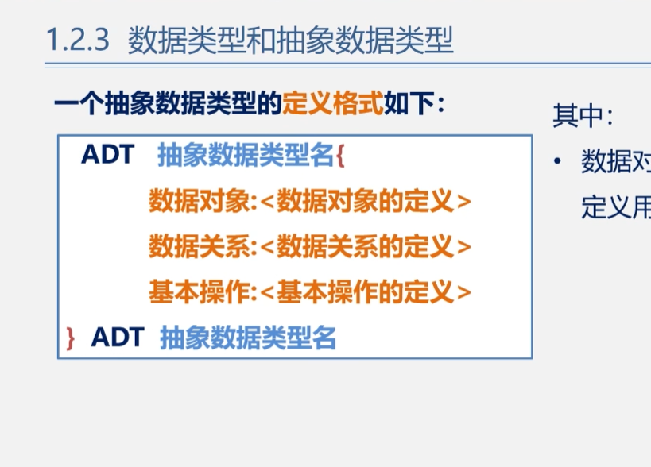

### 5. 基本操作的描述

| 项目 | 含义 |
| --- | --- |
| 操作名与参数表 | 说明操作名称、输入以及需要返回或修改的数据 |
| 初始条件 | 执行前数据结构和参数必须满足的条件；没有要求时可省略 |
| 操作结果 | 说明执行后的返回结果或数据状态变化 |

教材伪代码中的参数常分为：

- **值参数（赋值参数）：**为操作提供输入值，如 `Area(C)` 中的 `C`。
- **引用参数：**除提供输入外，还可返回结果或修改对象，常以 `&` 标记，如 `Circle(&C, r, x, y)` 中的 `C`。

> **易错点：**这里的 `&C` 是教材伪代码的表示约定。C 语言没有 C++ 那样的引用参数；C 中要修改调用者的对象，通常传入对象地址，通过指针操作。

### 6. ADT 示例：圆（Circle）

用半径和圆心坐标描述一个圆，并定义创建、求面积和求周长的操作。

```text
ADT Circle {
    数据对象：
        D = { (r, x, y) | r、x、y 为实数，且 r > 0 }
    数据关系：
        r 表示半径，(x, y) 表示圆心坐标
    基本操作：
        Circle(&C, r, x, y)
            初始条件：r > 0
            操作结果：构造半径为 r、圆心为 (x, y) 的圆 C
        Area(C)
            初始条件：圆 C 已存在
            操作结果：返回圆的面积 πr²
        Circumference(C)
            初始条件：圆 C 已存在
            操作结果：返回圆的周长 2πr
} ADT Circle
```

本例约定半径大于零；如果允许退化圆，也可以约定半径大于或等于零，但定义与操作条件要一致。

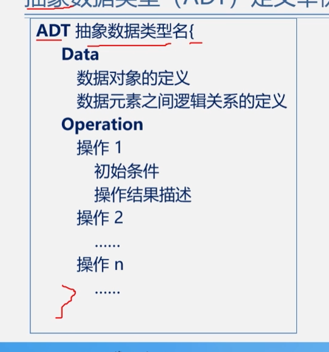

### 7. ADT 的表示与实现：复数示例

在 C 语言中实现 ADT，一般分为两步：

1. 用已有类型描述其存储结构。
2. 用函数实现其基本操作。

复数 `z = a + bi` 可以用实部 `a` 和虚部 `b` 表示。

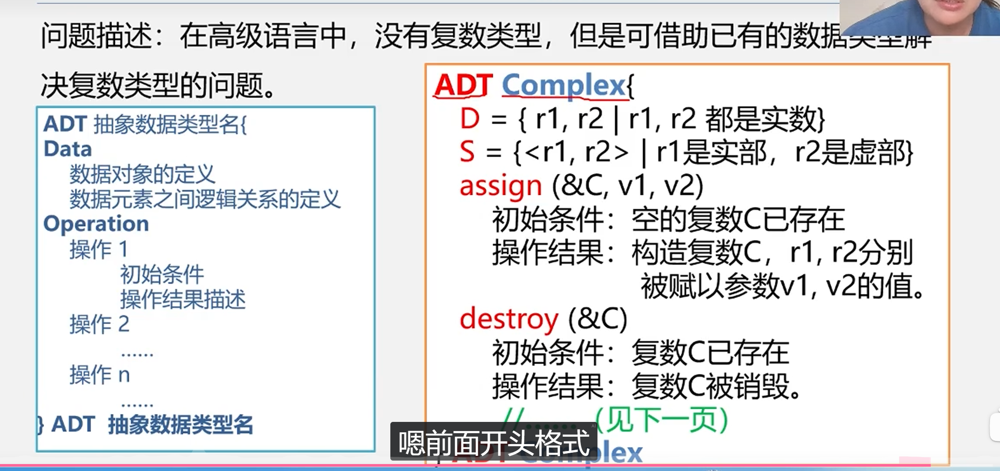

C 语言存储结构示例：

```c
typedef struct {
    float realpart;
    float imagpart;
} Complex;
```

复数加法的实现示例（整理时补充）：

```c
Complex AddComplex(Complex a, Complex b) {
    Complex result;
    result.realpart = a.realpart + b.realpart;
    result.imagpart = a.imagpart + b.imagpart;
    return result;
}
```

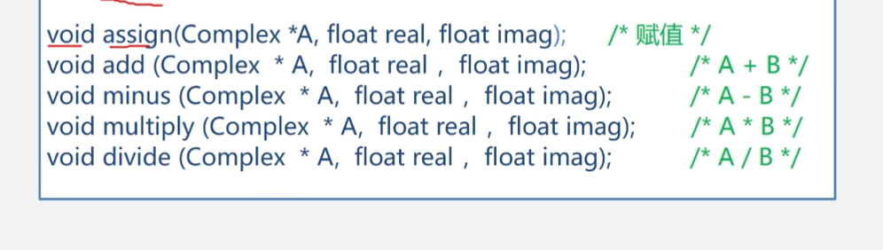

> **记忆要点：**ADT 规定“数据是什么、能做哪些操作”，具体实现决定“用什么类型存、用什么代码操作”。

## 二、算法与算法分析

### 1. 算法的定义与描述

**算法**是对特定问题求解方法和步骤的描述，是指令的有限序列，其中每条指令表示一个或多个操作。

简而言之，算法是解决问题的方法和步骤。

常见描述方式：自然语言、流程图、伪代码。

**算法与程序：**算法描述求解思路和步骤；程序是用某种编程语言写成的指令集合，可以实现算法。同一个算法可以用不同语言实现。程序不一定具有算法要求的有穷性，例如持续运行的服务程序。

### 2. 算法的五个基本特性

| 特性 | 含义 |
| --- | --- |
| 有穷性 | 执行有限步骤后结束，每一步也能在有限时间内完成 |
| 确定性 | 每条指令含义明确，没有歧义 |
| 可行性 | 每个操作都能通过有限次基本操作实现 |
| 输入 | 有零个或多个输入 |
| 输出 | 有一个或多个输出 |

### 3. 算法的设计要求

- **正确性：**满足问题要求，对合法输入得到正确结果。
- **可读性：**结构清楚，便于理解和维护。
- **健壮性：**对非法输入或异常情况作出合理处理。
- **高效性：**时间开销合理，存储空间使用适当。

### 4. 算法效率的分析方法

算法分析主要关注**时间效率**和**空间效率**。

| 方法 | 做法 | 特点 |
| --- | --- | --- |
| 事后统计 | 实现并运行程序，测量时间和空间开销 | 结果受硬件、语言、编译器、测试数据等影响 |
| 事前分析 | 运行前根据算法结构，估算基本操作次数和所需空间 | 便于比较输入规模增长时的资源变化趋势 |

> **易错点：**“将算法实现后测算时间和空间开销”属于事后统计，不属于事前分析。

### 5. 时间复杂度

算法的实际运行时间可粗略理解为：

```text
运行时间 ≈ Σ（语句执行次数 × 该语句执行一次所需时间）
```

分析时通常采用简化模型：把选定的基本操作视为消耗单位时间，关注其执行次数随输入规模 `n` 的变化。

设基本操作次数为 `T(n)`，用 `O(f(n))` 表示其渐近上界，常简称时间复杂度。

如果存在正常数 `c` 和 `n₀`，使得对所有 `n ≥ n₀` 都有：

```text
0 ≤ T(n) ≤ c · f(n)
```

则可写为 `T(n) = O(f(n))`。

常见化简方法：忽略常数因子和低阶项，保留主导增长的项。例如：

```text
T(n) = 2n³ + 3n² + 2n + 1
T(n) = O(n³)
```

> **易错点：**把基本语句视为单位时间，不代表整个算法就是 `O(n)`；还要统计执行次数。
>
> **补充：**如果 `T(n) / f(n)` 趋于一个非零有限常数，则二者同阶，可更精确地记为 `T(n) = Θ(f(n))`。`O` 表示上界，`Θ` 表示紧确的增长阶。

### 6. 示例：两个 n × n 矩阵相乘

常规矩阵乘法的核心伪代码：

```text
for i = 0 to n - 1
    for j = 0 to n - 1
        C[i][j] = 0
        for k = 0 to n - 1
            C[i][j] = C[i][j] + A[i][k] * B[k][j]
```

最内层的乘加操作执行 `n × n × n = n³` 次，所以时间复杂度为 `O(n³)`。

原笔记记录的计数式为 `T(n) = 2n³ + 3n² + 2n + 1`。具体系数取决于语句计数方式，复习时重点理解三层循环为什么带来三次方增长。

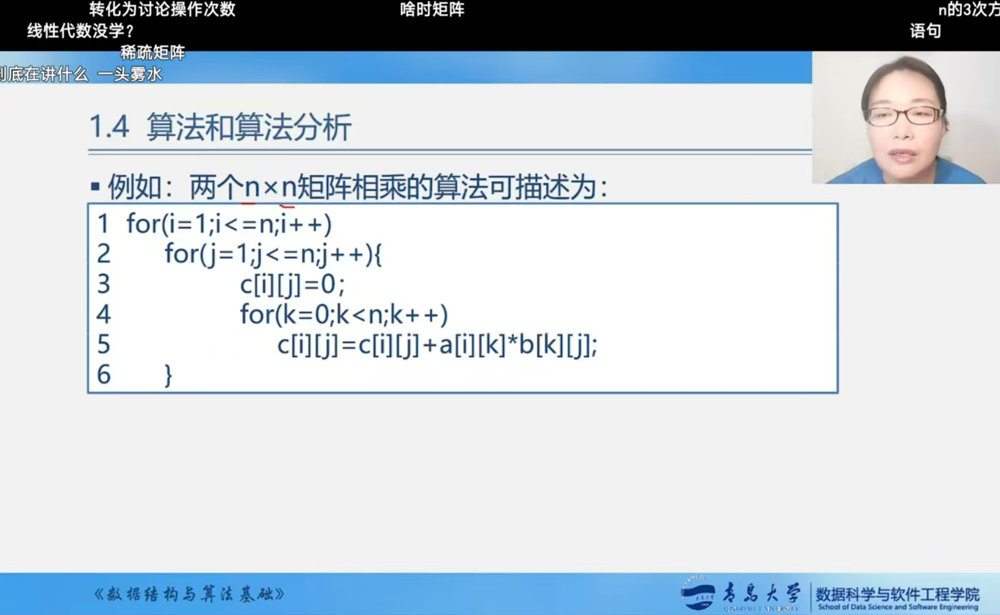

### 7. 常见时间复杂度（整理时补充）

常见增长速度从慢到快排列：

```text
O(1) < O(log n) < O(n) < O(n log n) < O(n²) < O(n³) < O(2ⁿ) < O(n!)
```

| 复杂度 | 典型例子 |
| --- | --- |
| `O(1)` | 按下标访问数组元素 |
| `O(log n)` | 在有序数组上进行二分查找 |
| `O(n)` | 遍历 n 个元素 |
| `O(n²)` | 两层循环，各自执行 n 次 |
| `O(n³)` | 常规 n × n 矩阵乘法 |

> **注意：**不能只按循环层数判断复杂度，要看循环范围和变量变化方式。同样规模的输入也可能导致不同操作次数，应说明分析的是最好、最坏还是平均情况。

### 8. 空间复杂度（补全）

**空间复杂度**描述算法所需存储空间随输入规模增长的趋势，常记作 `S(n) = O(g(n))`。

分析时要明确是否计入输入和输出空间；题目通常关注算法使用的**辅助空间**。

- 固定数量的临时变量：辅助空间通常为 `O(1)`。
- 额外建立长度为 n 的数组：辅助空间为 `O(n)`。
- 额外建立 n × n 的矩阵：辅助空间为 `O(n²)`。
- 使用递归：还要考虑递归调用栈占用的空间。

以矩阵乘法为例，若结果矩阵 C 计入额外空间，则需要 `O(n²)`；若 C 已由调用者提供，且只统计运算过程的临时变量，则该过程的辅助空间为 `O(1)`。

# 第二章线性表

## 线性表的定义、基本操作

定义：线性表是具有相同数据类型的n(n>=0)个数据元素的有限序列，其中n为**表长**，当n=0时线性表是一个空表。若用L命名线性表，则其一般表示为

    每个数据元素所占空间一样大
    有次序
    数据元素有限

ai 是线性表中的“第i个”元素线性表中的位序
a1 是表头元素；an 是表尾元素
继
除第一个元素外，每个元素有且仅有一个直接前驱:除最后一个元素外，每个元素有且仅有一个直接后继

### 线性表的基本操作
InitList(&L):初始化表。构造一个空的线性表L，分配内存空间。
Destroy(&L):销毁操作。销毁线性表，并释放线性表L所占的内存空间

ListInsert(&L,i,e):插入操作。在表L中的第i个位置上插入指定元素e.
ListDelete(&L,i,&e):删除操作。删除表中第i个位置的元素，并用e返回删除元素的值。

LocateElem(L,e):按值查找操作。在表L中查找具有给定关键字的元素。
GetElem(L,i):按位查找操作。获取表L中第i个位置的元素的值

Length(L):求表长。返回线性表L的长度即L中数据元素的个数。
PrintList(L):输出操作。按前后顺序输出线性表L的所有元素值。
Empty(L):判空操作。若L为空表，则返回true，否则返回false。
    
    Tips:
    对数据的操作 --创销，增删查改
    C语言函数的定义--<返回值类型>函数名（.......）
    实际开发中，可根据实际需求定义其他的基本操作
    函数名和参数的形式，命名都可以改变

## 顺序表的定义
### 定义

顺序表一一用顺序存储的方式实现线性表顺序存储。把逻辑上相邻的元素存储在物理位置上也相邻的存储单元中，元素之间的关系由存储单元的邻接关系来体现。

### 静态分配

```c
#define MaxSize 10
typedef struct{
    ElemType data[MaxSize];//用静态数组来存放数据元素
    int length; //顺序表的长度
}SqList;
```

eq:静态分配
```c++
#include <stdio.h>
#define MaxSize 10
typedef struct{
     int data[MaxSize];
     int length;
}Sqlist;//定义一个顺序表

void InitList(Sqlist &L){
    for(int i=0;i<MaxSize;i++)
        L.data[i]=0;
    L.length=0;
}//初始化顺序表

int main(){
    Sqlist L; //声明一个顺序表
    InitList(L);//初始化顺序表

    return 0;
}
```

### 动态分配
```c++
#include <stdio.h>
#define InitSize 10
using ElemType =  int;
typedef struct{
    ElemType *data;
    int Maxsize;
    int length;
}Sqlist;//定义一个顺序表

void InitList(Sqlist &L){
    L.data =new ElemType[InitSize]{};
    L.Maxsize =InitSize;
    L.length =0;
}//初始化顺序表

bool ListInsert(Sqlist &L, int i, int e){
    if (i < 1 || i > L.length + 1 || L.length >= L.Maxsize) return false;
    for(int j=L.length;j>=i;j--)
        L.data[j]=L.data[j-1];
    L.data[i-1]=e;
    L.length++;
    return true;
} // 插入操作

int main(){
    Sqlist L; //声明一个顺序表
    InitList(L);//初始化顺序表

    L.data[0]= 100;
    L.length =1;
    return 0;
}
```
### 顺序表的特点

    1.随机访问，即可以在O(1)时间找到第i个元素
    2.存储密度高
    3.拓展容量不方便

## 顺序表 插入，删除

### 插入
ListInsert(&L,i,e):插入操作。在表L中的第i个位置上插入指定元素e.

```c++
#define Maxsize 10

typedef struct {
    int data[Maxsize];
    int length;
}SqList;

bool ListInsert(SqList &L, int i, int e){  // 传入 第i个元素 和修改元素e
    if (i<1 || i>L.length+1)
        return false;
    if (L.length>=Maxsize)
        return false;
    for(int j=L.length;j>=i;j--)    // 循环，从有效元素尾部遍历 直到j < i
        L.data[j]=L.data[j-1];     // 把元素往后移一位
    L.data[i-1]=e;            // 在第i个位置插入元素e
    L.length++;
    return true;
} // 插入操作

void initList(SqList &L) {
    for (int i=0; i<Maxsize; i++) {
        L.data[i] = 0;
    }
    L.length = 0;
}

int main() {
    SqList L;
    initList(L);
    L.data[0] = 1;
    L.data[1] = 2;
    L.length=2;

    for (int i=0; i<L.length; i++) {
        cout << L.data[i] << " ";
    }

    cout << endl;
    ListInsert(L,1,3);

   
    for (int i=0; i<L.length; i++) {
        cout << L.data[i] << " ";
    }

}
```
应该考虑i的取值以及顺序表的容量，以及调用反馈（健壮性）

### 插入操作的时间复杂度
```c++
bool ListInsert(SqList &L, int i, int e){  // 传入 第i个元素 和修改元素e
    if (i<1 || i>L.length+1)
        return false;
    if (L.length>=Maxsize)
        return false;
    for(int j=L.length;j>=i;j--)    // 循环，从有效元素尾部遍历 直到j < i
        L.data[j]=L.data[j-1];     // 把元素往后移一位
    L.data[i-1]=e;            // 在第i个位置插入元素e
    L.length++;
    return true;
} // 插入操作
```
最好：新元素插入到表尾 O(1),循环0次
最坏：新元素插到表头 循环 n次 最坏 O(n)
平均：假设新元素插入到任何一个位置的概率相同 即i =1,2,3 .. length+1的概率都是 p=1/(n+1)
i=1 循环n次 ；i=2 ,循环 n-1 ...... i=n+1 循环 0次 
平均循环次数 n/2

### 删除
ListDelete(&L,i,&e):删除操作。删除表中第i个位置的元素，并用e返回删除元素的值。

```c++
#define Maxsize 10

typedef struct {
    int data[Maxsize];
    int length;
}SqList;

bool ListInsert(SqList &L, int i, int e){  // 传入 第i个元素 和修改元素e
    if (i<1 || i>L.length+1)
        return false;
    if (L.length>=Maxsize)
        return false;
    for(int j=L.length;j>=i;j--)    // 循环，从有效元素尾部遍历 直到j < i
        L.data[j]=L.data[j-1];     // 把元素往后移一位
    L.data[i-1]=e;            // 在第i个位置插入元素e
    L.length++;
    return true;
} // 插入操作

bool ListDelete(SqList &L, int i, int &e) {
    if (i<1 || i>L.length)
        return false;
    e=L.data[i-1];//将要被删除的元素赋值给 e
    for(int j=i;j<L.length;j++)//循环，从第i个元素起开始遍历，直到顺序表最大值
        L.data[j-1]=L.data[j]; //将后一个元素赋值给前一个元素
    L.length--;
    return true;
}//删除操作

void initList(SqList &L) {
    for (int i=0; i<Maxsize; i++) {
        L.data[i] = 0;
    }
    L.length = 0;
}

int main() {
    SqList L;
    initList(L);
    L.data[0] = 1;
    L.data[1] = 2;
    L.length=2;

    for (int i=0; i<L.length; i++) {
        cout << L.data[i] << " ";
    }

    cout << endl;
    ListInsert(L,1,3);


    for (int i=0; i<L.length; i++) {
        cout << L.data[i] << " ";
    }
    int e= 3;

    ListDelete(L,1,e);
    cout << endl;
    for (int i=0; i<L.length; i++) {
        cout << L.data[i] << " ";
    }

}

```

## 顺序表的查找
GetElem(L,i):按位查找操作。获取表L中第i个位置的元素的值

```c++
//查找操作  静态分配
int GetElem(SqList &L, int i) {
    return L.data[i-1];
}
```

```c++
#include <iostream>
using namespace std;
//动态分配
using ElemType =int;
#define InitSize 10
typedef struct {
    ElemType *data; //指针动态分配的表
    int Maxsize;  //最大容量
    int length;  //长度
}Sqlist;

void InitList(Sqlist &L) {
    L.data = new ElemType[InitSize]{}; //初始化表里的元素为 0
    L.Maxsize = InitSize; //定义最大容量为 10
    L.length = 0;  //初始化长度为0
}

ElemType GetElem(Sqlist &L, int i) {
    return L.data[i-1];//查找第i个元素的数据
}
// 访问和普通的数组访问和普通数组的访问方法一样
//如果一个ElemType 占6B,即sizeof(ElemType)==6
//指针data只想的地址为2000

void IncreaseSize(Sqlist &L,int len) {
    ElemType *p = L.data;
    L.data = new ElemType[L.Maxsize + len]{};  //申请一块新的内存空间
    for (int i = 0; i < L.length; ++i) {
        L.data[i] = p[i];
    }
    L.Maxsize += len;
    delete[] p; //顺序表扩容
}
int main() {
    Sqlist L{};  //声明一个表
    InitList(L); //初始化

    L.data[0] = 100; //元素赋值
    L.length=10; //设置长度

    for (int i = 0; i < L.length; ++i) {
        cout << L.data[i] << " ";
    }
    return 0;
}
```
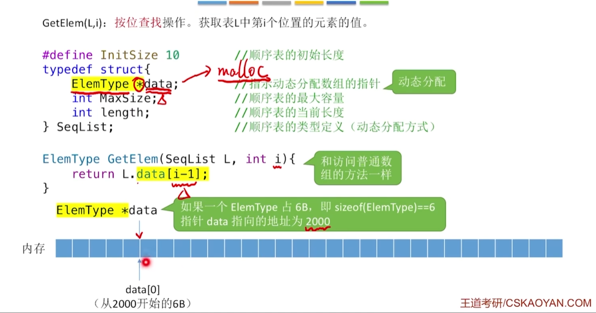

如果换一个类型的指针，指向同一个地址
int * p
就是2000 往后四个字节的 数据是p1

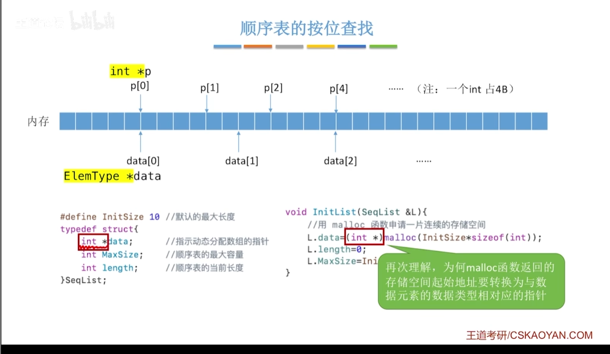

按位查找的时间复杂度为O(1)

### 按值查找

LocateElem(L,e):按值查找操作。在表L中查找具有给定关键字的元素。

```C++
int LocateElem(Sqlist L, ElemType e) {
    for (int i=0;i<L.length;i++) {
        if (L.data[i] == e)
            return i+1;  //数组下标为元素值等于e，返回其位序i+1
    }
    return 0;
}
```

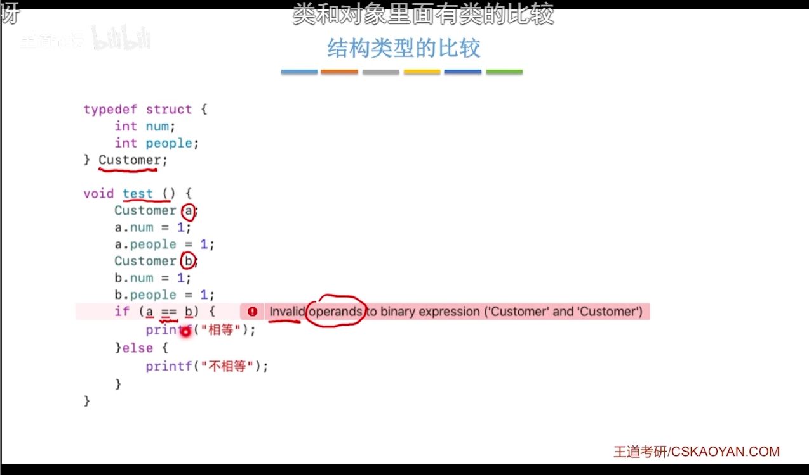

最坏和平均为O(n)

## 单链表
### 定义
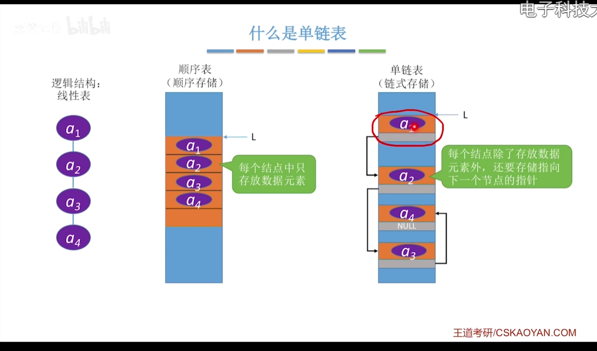

顺序表：每个节点只存放数据元素

单链表（链式存储）：每个节点除了存放数据元素外，还要存储指向下一个节点的指针


顺序表
    
    优点：可随机存取，存储密度高
    缺点：要求大片连续空间，改变容量不方便

单链表

    优点：不要求大片连续空间，改变容量方便
    缺点：不可随机存取，要耗费一定空间存放指针

### 用代码定义一个单链表

```C++
#include <iostream>
using namespace std;
using ElemType = int;

struct LNode { //定义单链表结点类型
    ElemType data; //每个节点存放一个数据元素 数据域
    struct LNode* next; //指针指向下一个节点 指针域
};
```

增加一个新的节点，在内存中申请一个节点所需空间，并用指针p指向这个节点
```c++
    LNode *p=new LNode;
```

要表示一个单链表时，只需声明一个头指针L，指向单链表的第一个节点

头插法
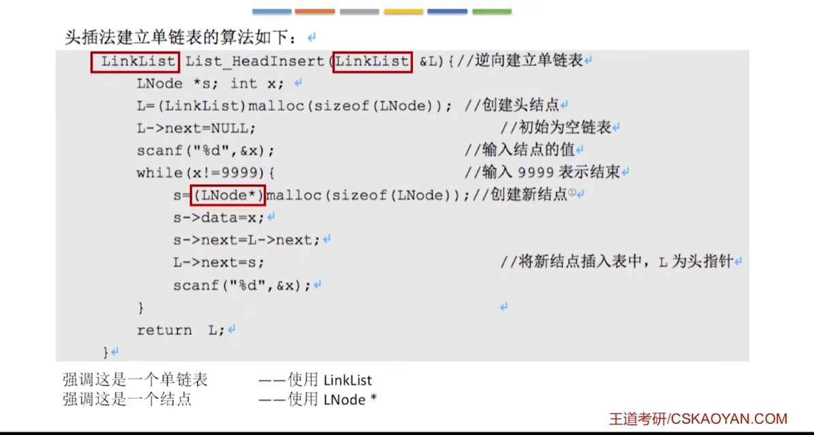

带头节点的初始化
```C++
bool InitList(LinkList& L) {
    L = new(nothrow) LNode; //申请一
    if (L == nullptr) return false;
    L->next = nullptr;
    return true;
}
```


## 单链表的 插入和删除

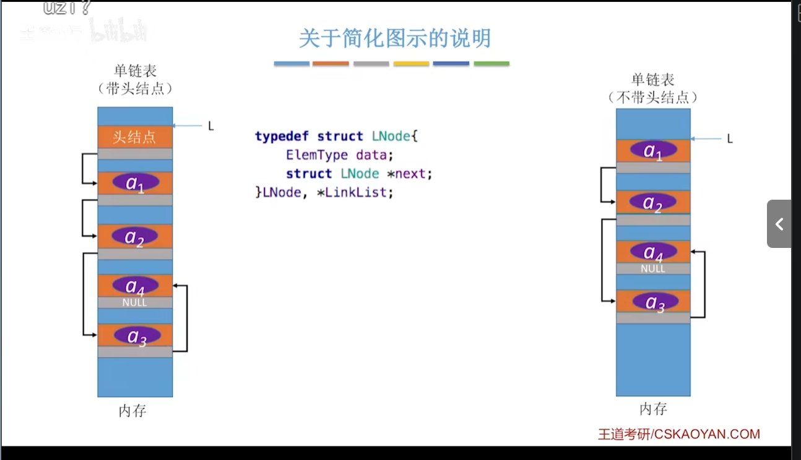

ListInsert(&L,i,e):插入操作。在表L中的第i个位置上插入指定元素e.

    需要找到 i-1个节点，将新节点插入其后

### 带头节点的插入
```C++
bool ListInsert(LinkList& L, int i, ElemType e) {
    if (i<1) 
        return false; //判断节点是否非法
    LNode *p; //定义一个新的指针变量 p
    int j=0;//当前p指向的是哪个节点
    p =L; //把L 的地址 给 p
    while (p != nullptr && j<i-1) {
        p = p->next;  //循环，让j找到 要修改节点的前趋节点
        j++; //自增
    }
    if (p == nullptr)
        return false;  //判断当前指针是否为空指针
    LNode* s = new LNode;  // 申请一个新的节点 s
    s->data = e;  // 把e所记录的值赋值给 s
    s->next = p->next; // 让s 节点指向后继节点
    p->next = s; //让前趋节点指向s
    return true;// 修改完成

}
```

### 按位序插入（不带头节点）
```C++
if(i==1){
    LNode *s = new LNode;
    s->data =e;
    s->next=L;
    L=s;//头指针指向新的节点 
    return true;
}

```


### 指定节点的后插操作

```C++
bool InsertNextNode(LNode *p, ElemType e) {
    if (p==nullptr)
        return false;
    LNode *s=new LNode;
    if (s== nullptr)
        return false;
    s->data = e;//用节点s保存数据元素e
    s->next = p->next; //s指向后继节点
    p->next = s; //将节点s连接到p
    return true;
}
```

### 指定节点的前插操作
//前插操作：在p节点插入元素e

```C++
bool InsertPriorNode (LinkList L,LNode *p,ElemType) //第一个参数 传入头指针 

```

```C++
bool InsertPriorNode (LinkList L,LNode *p,ElemType e) {
    if (p == nullptr)
        return false;
    LNode *s=new LNode;
    if (s== nullptr)
        return false;
    s->next = p->next; //把p的后继节点地址赋值给s的后继节点
    p->next = s; //p的节点指向s
    s->data = p->data; //将p中的元素赋值给s
    p->data = e;
    return true;
}
```

### 按位序删除（带头节点）

```C++
bool ListDelete(LinkList L,int i,ElemType &e) {
    if (i<1)
        return false;
    LNode *p;
    int j= 0;//指向当前p记录的指针
    p = L;
    while (p != nullptr && j<i-1 ) {
        p = p->next;
        j++;
    }
    if (p == nullptr) //i值不合法
      return false;
    if (p->next == nullptr)//第i-1个节点后已无其他节点
        return false;
    LNode* q = p->next;
    e = q->data;
    p->next=q->next;
    delete q;
    return true;
}
```

### 指定节点的删除
```C++
// 通过后继结点覆盖删除，不能用于尾结点
bool DeleteNode (LNode *p){
    if (p==nullptr || p->next==nullptr)
        return false;
    
    LNode *q =p->next;
    p->data=p->next->data;
    p->next =q->next;
    delete q;
    return true;

}
```

## 单链表的查找

GetElem(L,i):按位查找操作。获取表L中第i个位置的元素的值。
LocateElem(L,e):按值查找操作。在表L中查找具有给定关键字值的元素。

### 按位查找  
```C++
LNode * GetElem(LinkList L,int i){
    if(i<0)
        return NULL;
    LNode *p;
    int j=0;
    p=L;
    while (p!=nullptr && j<i){
        p=p->next;
        j++;
    }
    return p;
}

```

### 按值查找
```C++
LNode *locateElem(LinkList L,ElemType e){
    LNode *p =L->next;
    //从第一个节点开始查找数据域为e的节点
    while (p!= nullptr && p->data!=e)
        p=p->next;
    return p;
}

```

### 求表的长度
```C++
int length(LinkList L){

    int len =0;
    LNode *p =L;
    while (p->next !=nullptr){
        p = p->next;
        len++;
    }
    return len;
}
```

## 单链表的建立

### 尾插法建立单链表

```C++
typedef struct LNode{
    ElemType data;
    struct LNode *next;
}LNode,*LinkList;

bool InitList(LinkList &L){
    L = new LNode;
    if(L==NULL)
        return false;
    L->next =NULL;
    return true;
}
```
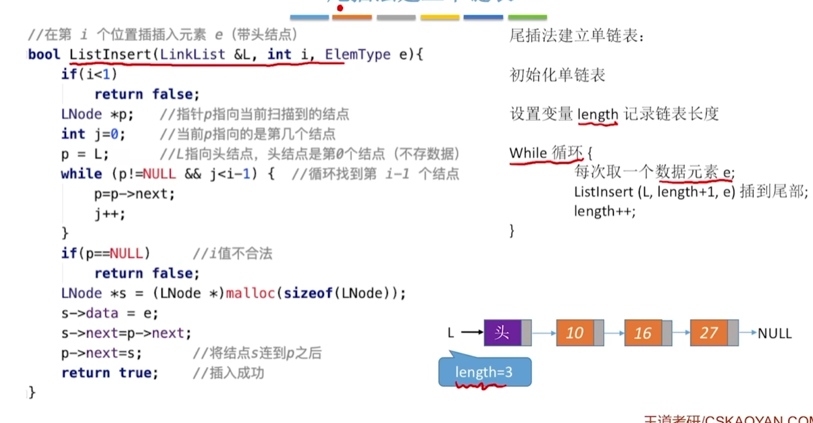

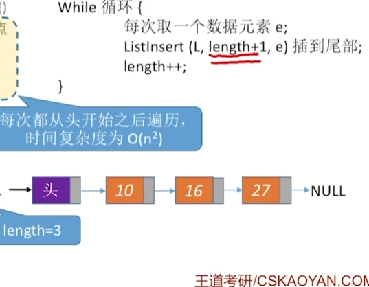

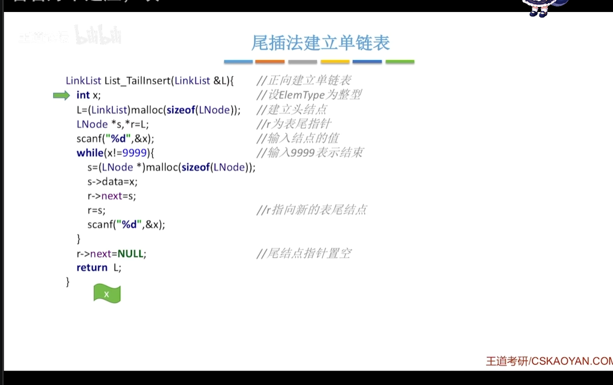

```c++
#include <iostream>
using namespace std;

// 定义结点结构
typedef struct LNode {
    int data;
    struct LNode *next;
} LNode, *LinkList;

// 尾插法正向建立单链表，输入9999结束
LinkList List_TailInsert(LinkList &L) {
    int x;
    L = new LNode;       // 新建头结点，替代malloc
    LNode *s, *r = L;     // r是尾指针，初始指向头结点
    cin >> x;
    while (x != 9999) {  //输入9999代表结束
        s = new LNode;
        s->data = x;
        r->next = s;
        r = s;
        cin >> x;
    }
    r->next = nullptr;    // 尾结点置空
    return L;
}
```

### 头插法建立单链表

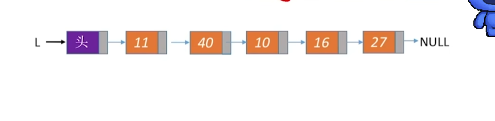

```C++
bool InsertNextNode (LNode *p,ElemType e){
    if(p == NULL )
        return false;
    LNode *s =new LNode;
    if(s == NULL)
        return false;
    s->data = e;
    s->next = p->next;
    p->next =s ;
    return true;
}
```

逆向建立单链表
```C++
#include <iostream>
using namespace std;

typedef struct LNode {
    int data;
    struct LNode *next;
} LNode, *LinkList;

// 头插法建立单链表（逆向建表，输入9999结束）
LinkList List_HeadInsert(LinkList &L) {
    LNode *s;  //创建一个指针变量
    int x;   // 需要加入的变量
    L = new LNode;        // 创建头结点
    L->next = nullptr;    // 初始空链表
    cin >> x;
    while (x != 9999) {  //输入 9999时 ，结束循环
        s = new LNode;  //开辟一个节点
        s->data = x;  //把数据放入data
        s->next = L->next; // 把节点接入后面的节点
        L->next = s;       // 头结点指向新结点
        cin >> x;
    }
    return L;
}
```

## 双链表
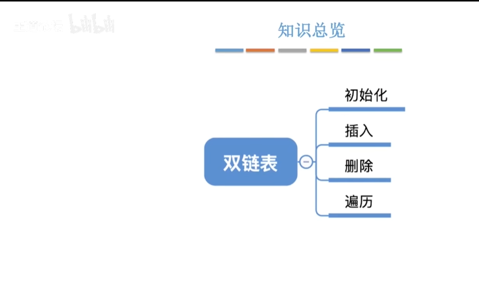

### 双链表的定义

```C++
typedef struct DNode {
    ElemType data;
    struct DNode *prior, *next;  //前趋 后继节点
} DNode, *DLinkList;
```
现代写法
```c++
struct DNode {
    int data;
    DNode *prior;
    DNode *next;
};
using DLinkList = DNode*;
```
```C++
//初始化双链表  带头节点
bool InitDLinkList(DLinkList &L){
    L = new DNode;
    if(L == NULL)
        return false;
    L->prior = NULL; //头节点的prior永远指向 NULL
    L->next = NULL;
    return true;
}

void testDLinkList(){
    DLinkList L;
    InitDLinkList(L);
}
```

### 双链表的插入
在p节点后插入s节点
```C++
bool InsertNextDNode(DNode *p,DNode *s){

    if(p==NULL || s==NULL)  //非法参数
        return false;
    s->next=p->next;
    if(p->next !=NULL)  //如果p节点后有后继节点
        p->next->prior =s;
    s->prior =p;
    p->next =s;
    return true;
}   
```

### 双链表的删除
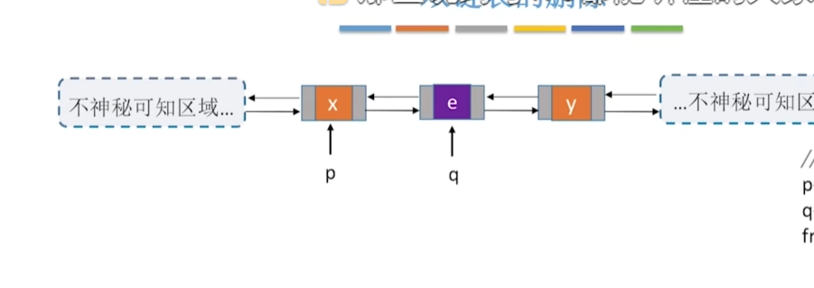

```C++
    p->next =q->next;
    q->next->prior=p;
    delete q;
```
如果刚好删除最后一个节点，会出现空指针错误

```C++
bool DeleteNextDNode(DNode *p) {
    if (p == nullptr)
        return false; 
    DNode *q = p->next; //找到p的后继节点 q
    if (q == nullptr)
        return false;
    p->next = q->next;  //把p的下一个地址记录为q的下一个地址 
    if (q->next != nullptr)//q的下一个地址不为空
        q->next->prior = p;  //q下一个地址的前趋地址记录为p的地址
    delete q;    // 释放q的内存
    return true;
}
```

### 双链表的遍历

```C++
while(p!=nullptr){
    p=p->next;
    
}//后向遍历

while(p!=nullptr){
    p=p->prior;
}
```

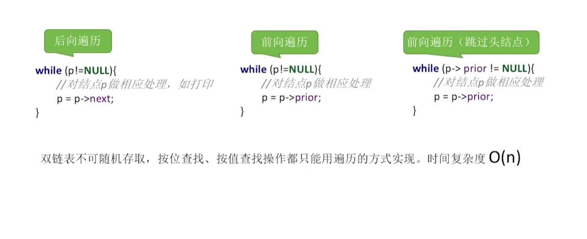

## 循环链表
### 循环单链表

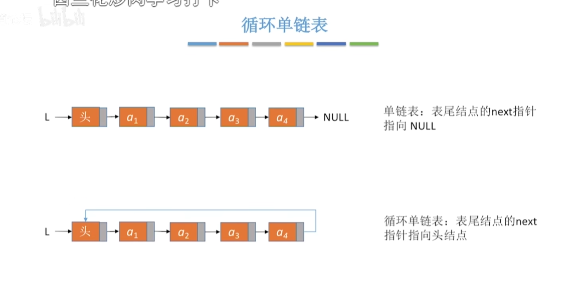
```C++
//初始化循环链表
typedef struct LNode{

    ElemType data;
    struct LNode *next;
}LNode,*LinkList;

bool InitList(LinkList &L){
    L = new LNode;
    if(L==nullptr)
        return false;
    L->next =L;//先让头节点指向本身
    return true;
}
```
循环单链表：从一个节点出发可以找到其他任何一个节点

### 循环双链表
表头节点的prior指向表尾节点；
表尾节点的next指向头节点
```C++
bool InitDLinkList(DLinkList &L){
    L= new DNode;
    if(L==nullptr)
        return false;
    L->prior=L;
    L->next=L;
    return true;
}   

//判断循环链表是否为空
bool Empty(DLinkList L){
    if(L->next==L)
        return true;
    else
        return false;
}

//双链表的插入
bool InsertNextDNode(DNode *p,DNode *s){
    s->next = p->next;
    p->next->prior=s;
    s->prior =p;
    p->next = s;
    return true;
}
```
## 静态链表
### 什么是静态链表

静态链表:分配一整片连续的内存空间，各节点集中安置
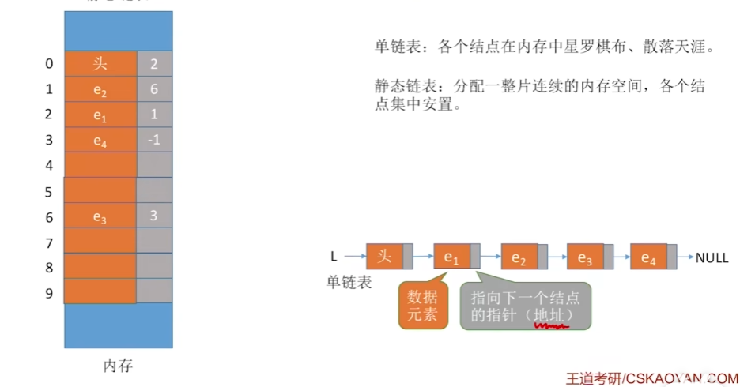

每个数据元素4B，每个游标4B（每个节点共8B），设起始地址位addr

### 静态链表的定义

```C++
#define MaxSize 10
struct Node{
    ElemType data;
    int next;
};

```
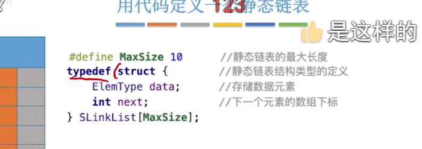

## 顺序表 VS 链表
### 逻辑结构
都属于线性表，是线性结构

**顺序表**：
    
    优点：支持随机存取，存储密度高
    缺点：大片连续空间分配不方便，改变容量不方便

**链表**：

    优点：离散的小空间分配方便，改变容量方便
    缺点：不可随机存取，存储密度低

# 第三章 栈和队列
## 栈（Stack） 基本概念
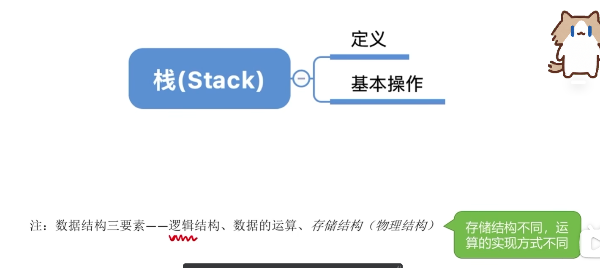
### 栈的定义
栈 ：是只允许在一端进行插入或删除操作的线性表
先进后出
重要术语：栈顶、栈底、空栈

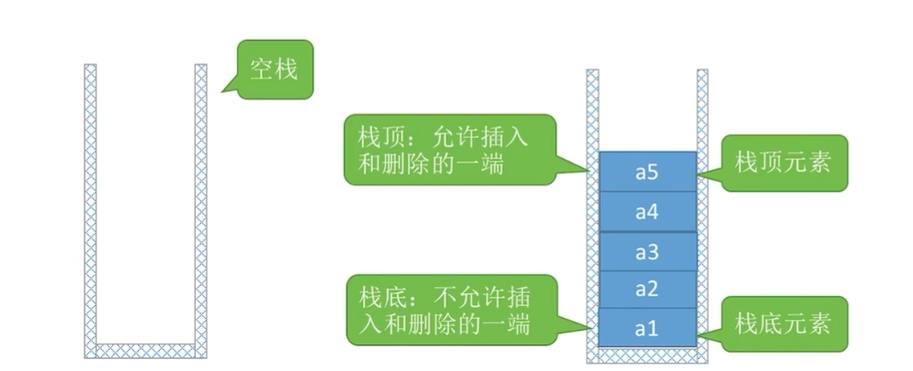

### 栈的基本操作

InitStack (&S): 初始化栈。构造一个空栈 S，分配内存空间。
DestroyStack (&S): 销毁栈。销毁并释放栈 S 所占用的内存空间。

Push (&S,x)：进栈，若栈 S 未满，则将 x 加入使之成为新栈顶。
Pop (&S,&x)：出栈，若栈 S 非空，则弹出栈顶元素，并用 x 返回。

GetTop (S,&x)：读栈顶元素。若栈 S 非空，则用 x 返回栈顶元素。

StackEmpty (S)：判断一个栈 S 是否为空。若 S 为空，则返回 true，否则返回 false。

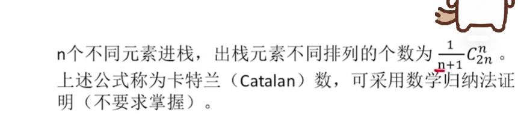

## 顺序栈的实现
### 顺序栈的定义
```C++
#define MaxSize 10
typedef struct{
    ElemType data[MaxSize];
    int top;
}SqStack;

//初始化栈
void InitStack(SqStack &S){
    S.top =-1;
}
//新元素入栈
bool Push(SqStack &s, ElemType e) {
    if (s.top==MaxSize-1)//栈满 报错
        return false;
    s.data[++s.top]=e;
    return true;
}

//元素出栈
bool Pop(SqStack &s, ElemType &e) {
    if (s.top==-1)
        return false;
    e=s.data[s.top];
    s.top--;
    return true;
}

void testStack(){
    SqStack S; //声明一个顺序栈
    //...后续操作...
} 
```

### 共享栈
两个栈共享同一片空间
```C++
#define MaxSize 10
typedef struct{
    ElemType data[MaxSize];
    int top0;   // 0号栈栈顶
    int top1;   // 1号栈栈顶
} ShStack;

void InitStack(ShStack &S){
    S.top0 = -1;
    S.top1 = MaxSize;
}
```
判断栈满的条件
top0+1 == top1

## 栈的链式存储
### 链栈的操作
```C++
typedef struct LinkNode{
    ElemType data;
    struct LinkNode *next;
}*LiStack;
```

## 队列的基本概念
### 定义
队列：仅允许在一端进行插入，在另一端进行删除的线性表
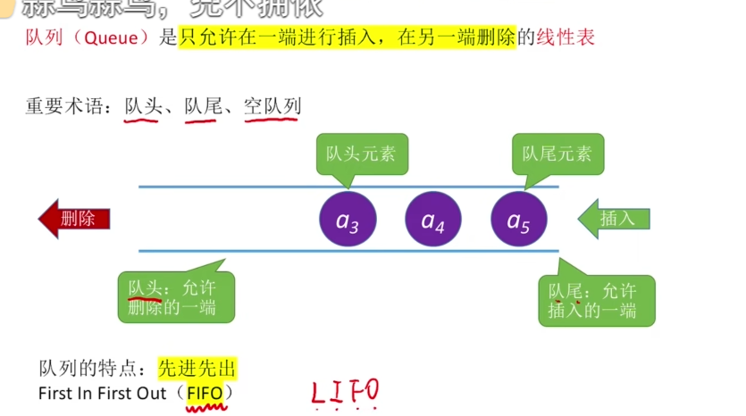

特点：先进先出

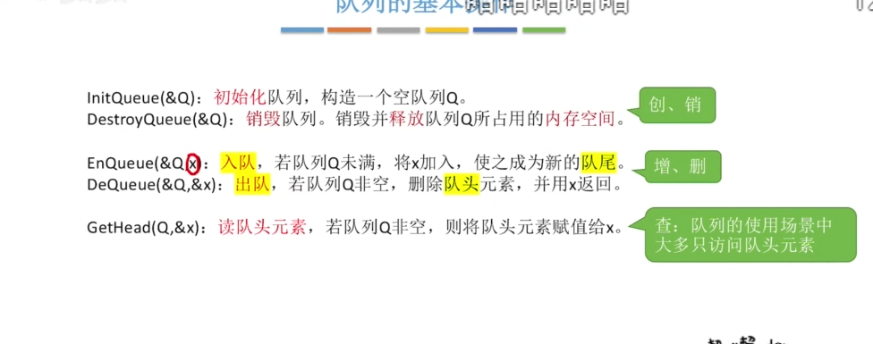

## 队列的顺序实现

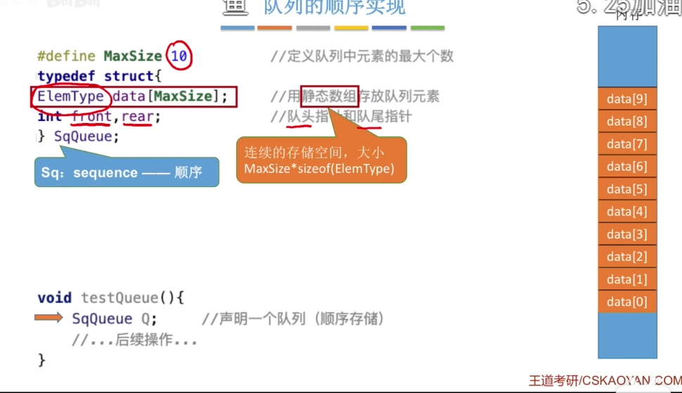
```C++
#include <iostream>
using namespace std;
using ElemType=int;
#define Maxsize 10

typedef struct {
    ElemType data[Maxsize];
    int front,rear;  //队头指针和队尾指针
}SqQueue;
   
```

front指向队头元素，rear指向队尾元素的下一个位置也就是需要插入的位置
```C++
void InitSqQueue(SqQueue &q) {
    q.rear=q.front=0;  //队列初始化
}
bool QueueEmpty(SqQueue q) {
    return q.rear==q.front;  //判断队列是否为空
}
```

```C++

//插入操作
bool EnQueue(SqQueue &q,ElemType x) {
    if ((q.rear+1)%Maxsize == q.front)//适用于循环队列
        return false;
    q.data[q.rear]=x; //将X插入队尾
    q.rear=(q.rear+1)%Maxsize;//将队尾指针后移
    return true;
}

```
此操作是循环队列。

队列已满的条件：队尾指针的再下一个位置是队头，即(q.rear+1)%Maxsize == q.front 

出队操作
```C++
bool DeQueue(SqQueue &Q,ElemType &x){
    if(Q.rear == Q.front)
        return false;
    x=Q.data[Q.front];
    Q.front=(Q.front+1)%Maxsize; //逻辑删除
    return true;
}

```

查找操作
```C++
bool GetHead(SqQueue Q,ElemType &x){
    if(Q.rear == Q.front)
        return false;
    x=Q.data[Q.front];
    return true;
}
```

### 方案一：判断队列已满/已空
队列已满的条件：队尾指针的再下一个位置是队头，即 (Q.rear+1)%MaxSize == Q.front

队空条件：Q.rear == Q.front

队列元素的个数：
（rear+MaxSize-front）%MaxSize

### 方案二
在构造队列的时候，在里面添加一个size 用于记录当前队列的长度
```C++
#include <iostream>
using namespace std;
using ElemType=int;
#define Maxsize 10

typedef struct {
    ElemType data[Maxsize];
    int front,rear;  //队头指针和队尾指针
    int size;
}SqQueue;
```
初始化时 ，rear=front=0；size=0;
插入成功size++
删除成功size--

### 方案三 判断队列已满/已空
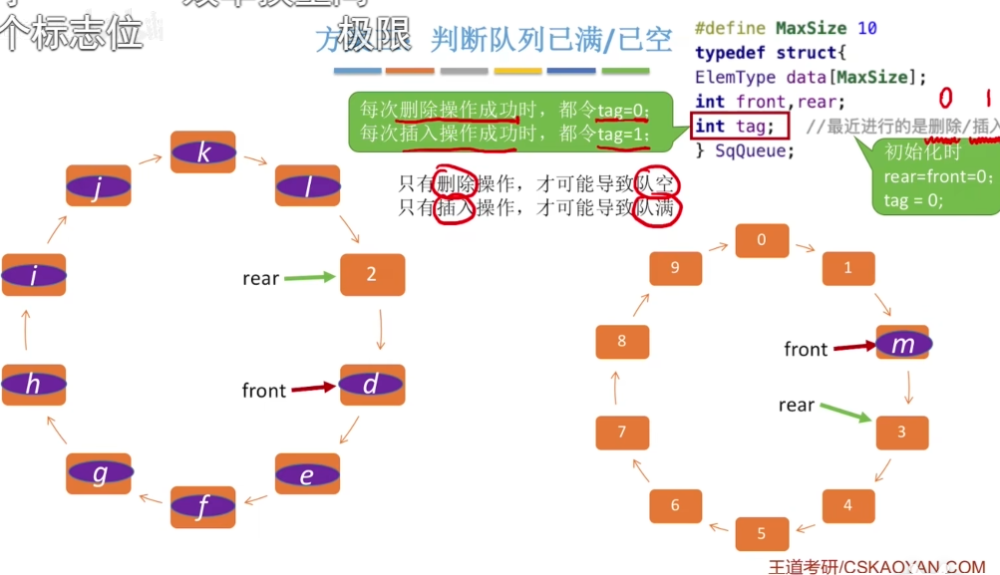
```C++
#include <iostream>
using namespace std;
using ElemType=int;
#define Maxsize 10

typedef struct {
    ElemType data[Maxsize];
    int front,rear;  //队头指针和队尾指针
    int tag;
}SqQueue;
```
每次删除操作成功时，令tag=0,
每次插入操作成功时，令tag=1,
队满满足条件：
    front == rear && tag ==1 
队空满足条件：
    front == rear && tag ==0
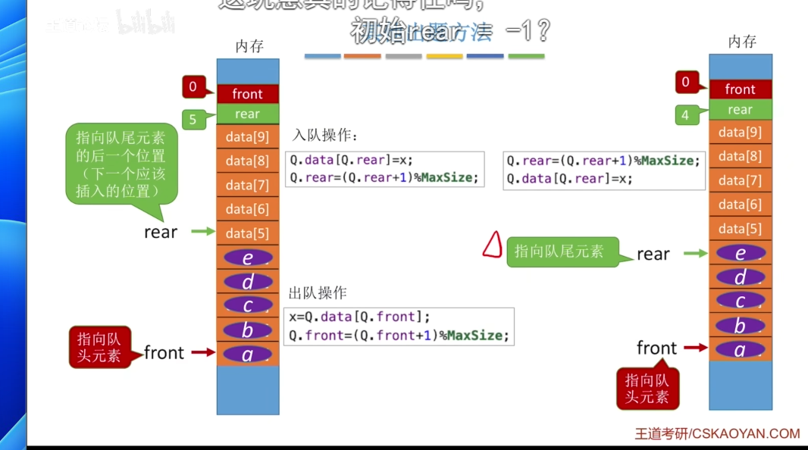

## 队列链式实现

### 队列的链式实现
带头节点
```C++
typedef struct LinkNode{   //链式队列节点
    ElemType data;
    struct LinkNode *next;
}LinkNode;

typedef struct{
    LinkNode *front,*rear;
}LinkQueue;

void InitQueue(LinkQueue &Q){
    //初始时 front、rear 都指向头节点
    Q.front = Q.rear = new LinkNode;
    Q.front->next =nullptr;
}
bool IsEmpty(LinkQueue Q){
    return Q.front==Q.rear;
}
//出队（带头节点）
bool DeQueue(LinkQueue &Q,ElemType &x){
    if(Q.front == Q.rear)
        return false;//空队
    LinkNode *p = Q.front->next;
    x=p->data;
    Q.front->next = p->next;
    if(Q.rear == p)
        Q.rear =Q.front;
    delete(p);
    return true;
}


void EnQueue(LinkQueue &Q,ElemType x){
    LinkNode *s=new LinkNode();
    s->data=x;
    s->next=nullptr;  //s下一节点指向空
    Q.rear->next=s;     //尾指针的下一节点指向s
    Q.rear= s;
}

```
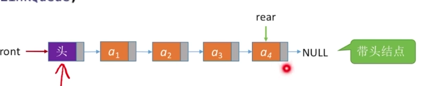

不带头节点
```C++
typedef struct LinkNode{   //链式队列节点
    ElemType data;
    struct LinkNode *next;
}LinkNode;

typedef struct{
    LinkNode *front,*rear;
}LinkQueue;

void InitQueue(LinkQueue &Q){
    //初始时 front、rear 都指想null
    Q.rear=nullptr;
    Q.front=nullptr;
}

void EnQueue(LinkQueue &Q,ElemType x){
    LinkNode *s =new LinkNode();
    s->data =x;
    s->next= nullptr;
    if(Q.front ==nullptr){//在空队列中插入第一个元素
        
        Q.front =s;
        Q.rear =s;
    }else{
        Q.rear->next=s; //新节点插入到rear节点之后
        Q.rear= s; //修改raer指针
    }

}


//ch

bool IsEmpty(LinkQueue Q){
    return Q.front ==nullptr;
}
```

出队不带头节点
```C++
bool DeQueue(LinkQueue &Q,ElemType &x){
    if(Q.front == nullptr )
        return false;
    LinkNode *p =Q.front;
    x=p->data;
    Q.front=p->next;
    if(Q.rear==p){
        Q.front =nullptr;
        Q.rear =nullptr;
    }
    delete(p);
    return true;
}
```
### 队列满的条件
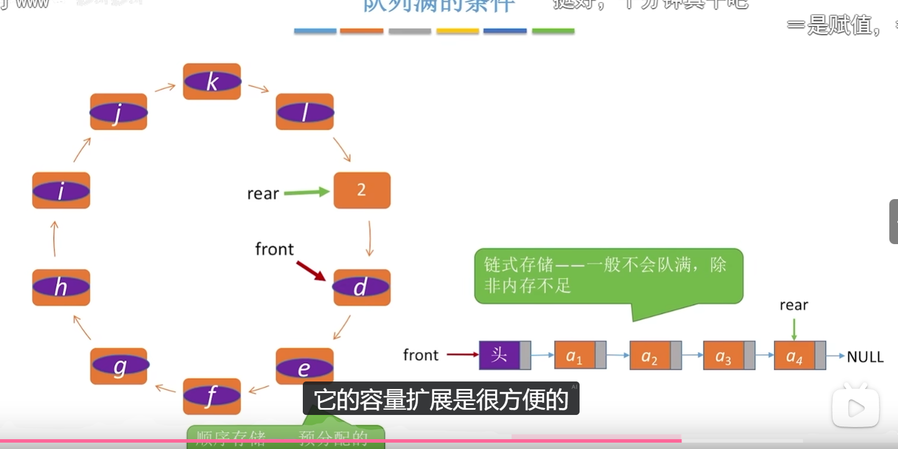


## 双端队列
### 双端队列
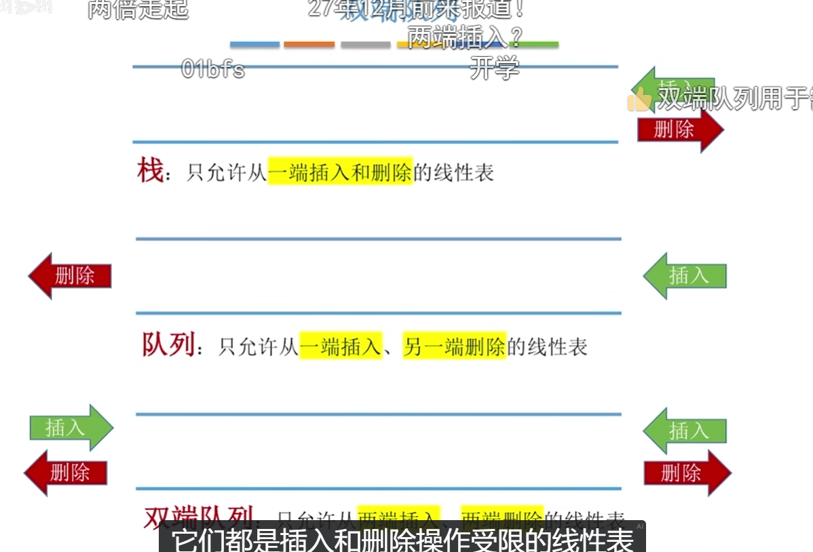

双端队列：只允许从两端插入，两端删除的线性表

若只使用其中一段的插入、删除操作，则效果等同于栈。

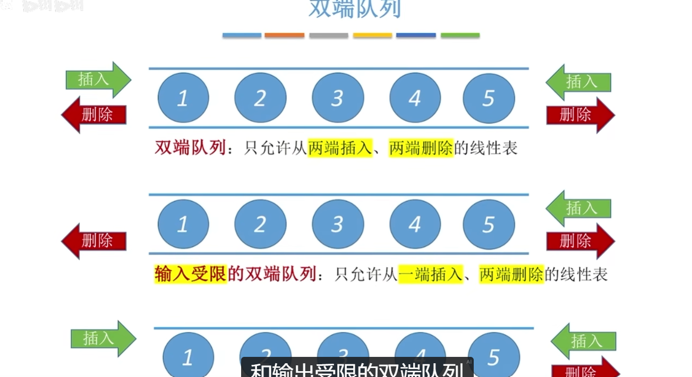

### 判断输出序列的合法性

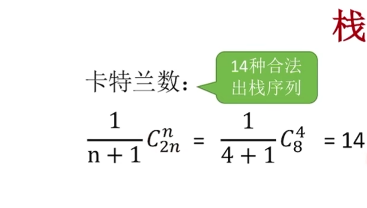

卡特兰数
$\frac{1}{n+1}\mathrm{C}_{2n}^{\,n}$

输入受限的双端队列
栈中合法的序列，双端队列一定合法

## 栈的应用--括号匹配
### 括号匹配问题


## 表达式求值
### 熟悉的算数表达式
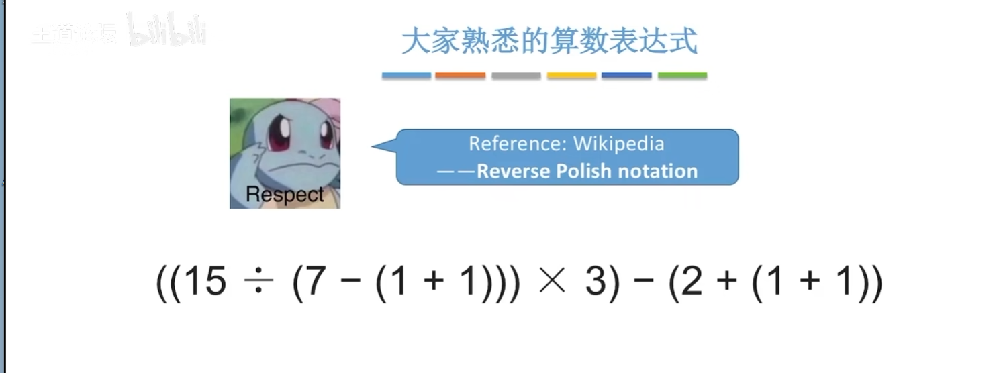
由三个部分组成：操作数、运算符、界限符

### 中缀，前缀，后缀表达式


中缀转为后缀表达式：
定义一个运算栈： ops
定义一个后缀表达式序列： postfix

遇到数字，直接压入：postfix;
遇到 (，压入运算符栈。
遇到)，弹出运算符栈直到遇到 (，再将 ( 出栈。
遇到运算符，先弹出栈顶优先级大于或等于当前运算符的运算符（遇到左括号停止），再压入当前运算符。
扫描结束后，弹出剩余运算符。

### 栈的应用--递归
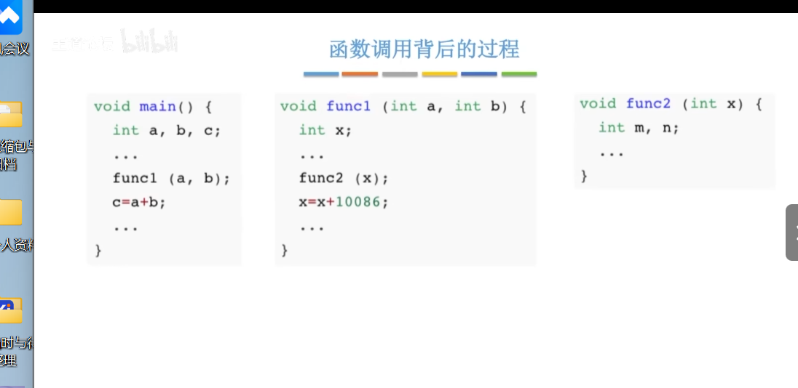

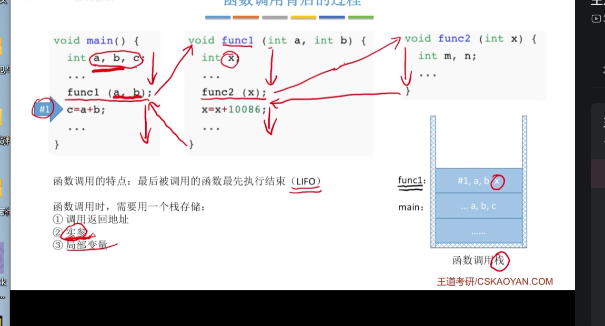

适合用“递归”算法解决：可以把原始问题转化为属性相同，但规模较小的问题
```C++
#include<iostream>
using namespace std;

int factorial(int n) {
    if(n==1||n==0)
        return 1;
    return n*factorial(n-1);
}

int main() {
    cout<<factorial(10);
}
```
递归调用时，函数调用栈可称为“递归调用栈”

## 队列应用
### 树的层次遍历

### 图的广度优先遍历

## 特殊矩阵压缩存储
### 一维数组的存储结构
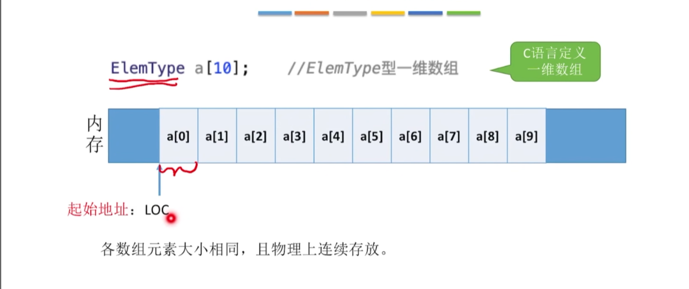
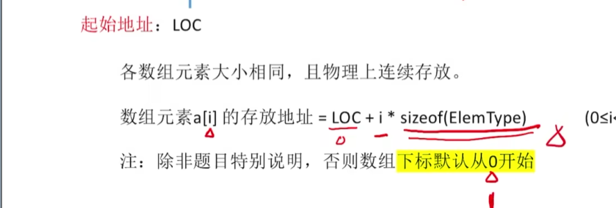

## 二维数组的存储结构
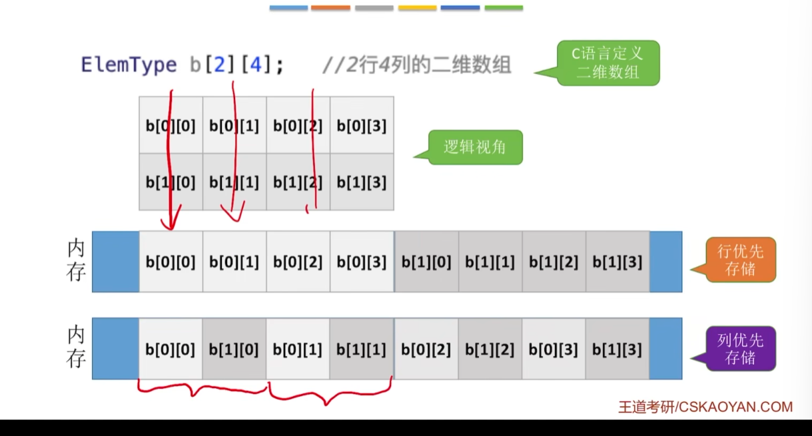 

M 行 N 列的二维数组 b [M][N] 中，若按行优先存储，则
b [i][j] 的存储地址 = LOC + (i*N + j) * sizeof (ElemType)


# 第四章 串
## 串 定义 基本操作
### 串的定义
串，即字符串（String）是由零个或多个字符组成的有限序列。一般记为
\(S = `a_1a_2\cdots\cdots a_n' \quad (n \ge 0)\)
其中，S是串名，单引号括起来的字符序列是串的值；\(a_i\)可以是字母、数字或其他字符；串中字符的个数n称为串的长度。\(n=0\)时的串称为空串（用\(\emptyset\)表示）。

例:
S="HelloWorld!"
T='iPhone 11 Pro Max?'

子串：串中任意个连续字符组成的子序列
主串：包含字串的串
*字符在主串中的位置* ：字符在串中的序号
*子串在主串中的位置*：子串的第一个字符在主串中的位置
空串VS空格串
M=''  N=' '
### 串VS线性表
串是一种特殊的线性表，数据元素之间呈线性关系

串的数据对象限定为字符集（如中文字符、英文字符、数字字符、标点字符等）
串的基本操作，如增删改查等通常以子串为操作对象

### 串的基本操作
假设有串 T=""，S="iPhone 11 Pro Max?"，W="Pro"
StrAssign (&T,chars)：赋值操作。把串 T 赋值为 chars。
StrCopy (&T,S)：复制操作。由串 S 复制得到串 T。
StrEmpty (S)：判空操作。若 S 为空串，则返回 TRUE，否则返回 FALSE。
StrLength (S)：求串长。返回串 S 的元素个数。
ClearString (&S)：清空操作。将 S 清为空串。
DestroyString (&S)：销毁串。将串 S 销毁（回收存储空间）。
Concat(&T,S1,S2)：串连接。用T返回由S1和S2连接而成的新串

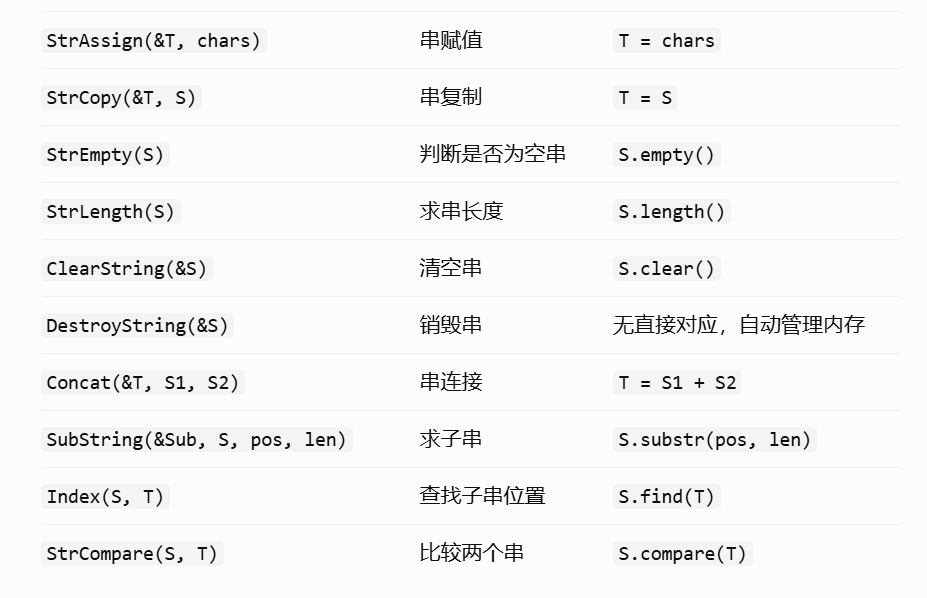

注意：408 教材通常将串的第一个字符位置记为 1，而 C++ std::string 的下标从 0 开始。

SubString (&Sub,S,pos,len)：求子串。用 Sub 返回串 S 的第 pos 个字符起长度为 len 的子串。
Index (S,T)：定位操作。若主串 S 中存在与串 T 值相同的子串，则返回它在主串 S 中第一次出现的位置；否则函数值为 0。
StrCompare (S,T)：比较操作。
若 S > T，则返回值 > 0；若 S = T，则返回值 = 0；若 S < T，则返回值 < 0。

## 串的存储结构
### 串的顺序存储
```C++
#define MAXLEN 255
typedef struct{
    char ch[MAXLEN + 1];
    int length;
}SString; //定长的顺序存储

typedef struct{
    char *ch;
    int length;
}HString;//动态数组实现h

int main(){
    HString S;
    S.ch = nullptr;
    S.length =0;
} //初始化空串，字符空间可按需分配
```

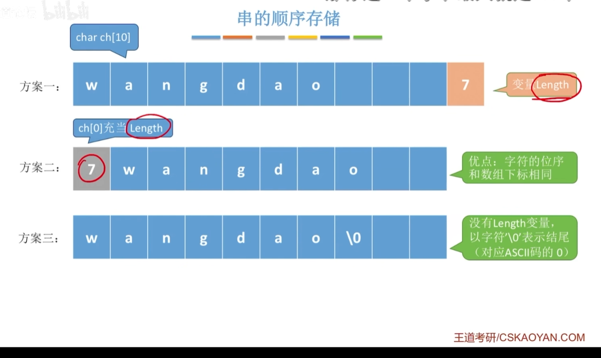
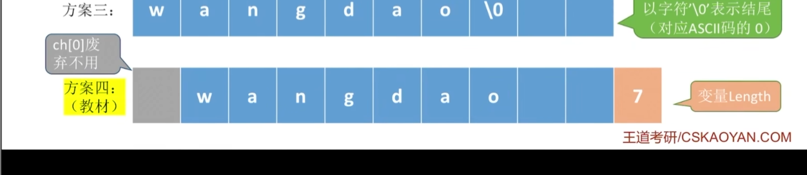

### 串的链式存储
```C++
typedef struct StringNode{
    char ch; //每个节点保存一个字符
    struct StringNode * next;
}StringNode,* String;  //存储密度低，每个字符1B，指针大小取决于平台


typedef struct StringNode{
    char ch[4]; //每个节点存储多个字符
    struct StringNode *next;
}StringNode,* String; //存储密度提高
```

### 基本操作实现

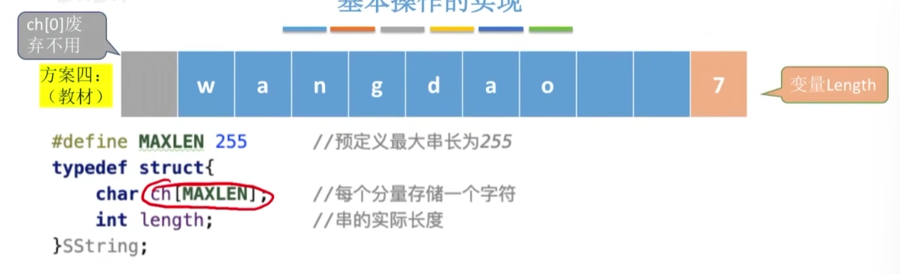
```C++
#define MAXLEN 255
typedef struct{
    char ch[MAXLEN + 1];
    int length;
}SString;
```

SubString (&Sub,S,pos,len)：求子串。用 Sub 返回串 S 的第 pos 个字符起长度为 len 的子串。

求子串
```C++
bool SubString(SString &Sub,SString S,int pos,int len){
    //子串范围越界
    if(pos < 1 || len < 0 || pos > S.length + 1 || len > S.length - pos + 1)
        return false;
    for(int i=pos;i<pos+len;i++)
        Sub.ch[i-pos+1] =S.ch[i];
    Sub.length =len;
    return true;
} 
```

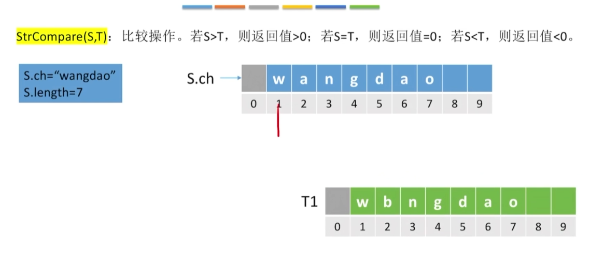

StrCompare (S,T)：比较操作。若 S>T，则返回值 > 0；若 S=T，则返回值 = 0；若 S<T，则返回值 < 0。


比较操作
```C++
int StrCompare(SString S,SString T){
    for(int i=1;i<=S.length && i<=T.length; i++){
        if (S.ch[i]!=T.ch[i])
            return S.ch[i]-T.ch[i];
    }
    return S.length-T.length;
}
```

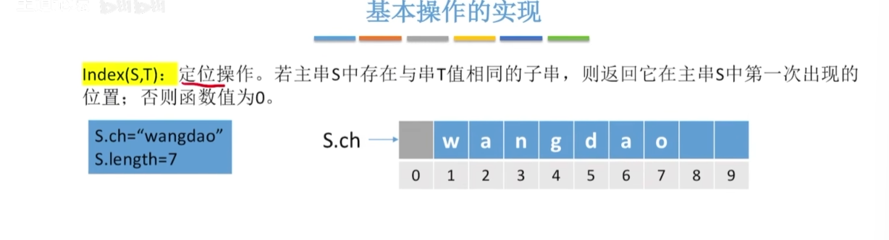
Index (S,T)：定位操作。若主串 S 中存在与串 T 值相同的子串，则返回它在主串 S 中第一次出现的位置；否则函数值为 0。

```C++
int Index(SString S,SString T){
    int i=1,n=StrLength(S),m=StrLength(T);
    SString sub;
    while(i<=n-m+1){
        SubString(sub,S,i,m);
        if(StrCompare(sub,T)!=0) ++i;
        else return i;
    }
    return 0;
}
```


## 字符串 朴素模式匹配算法

### 朴素模式匹配算法
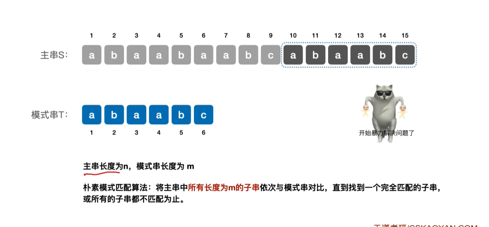
主串长度为 n，模式串长度为 m
朴素模式匹配算法：将主串中所有长度为 m 的子串依次与模式串对比，直到找到一个完全匹配的子串，或所有的子串都不匹配为止。

最多对比 max(0, n-m+1) 个子串

index函数思想就是朴素模式匹配算法
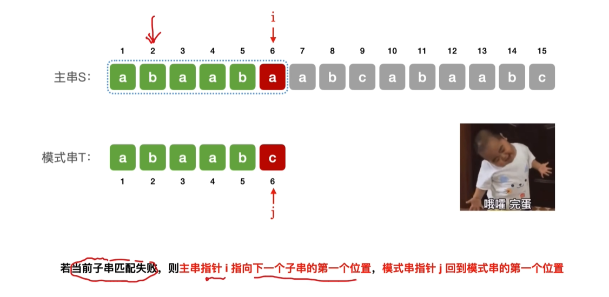

i=i-j+2
j=1

若 j > T.length，则当前子串匹配成功，返回当前子串第一个字符的位置—— i - T.length
```C++
int Index(SString S,SString T){
    int i=1,j=1;
    while(i<=S.length && j<=T.length){
        if(S.ch[i]==T.ch[j]){
            ++i;++j;
        }
        else{
            i=i-j+2;
            j=1;
        }
    }
    if(j>T.length)
        return i-T.length;
    return 0;
}
```

## 字符串 KMP算法

### KMP算法

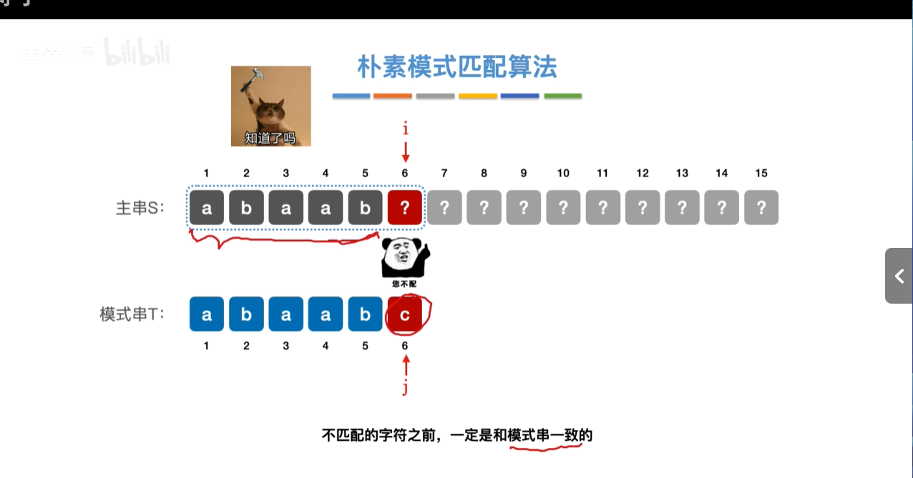

对于模式串 T='abaabc'，当第 6 个元素匹配失败时，可令主串指针不变，模式串指针j=3

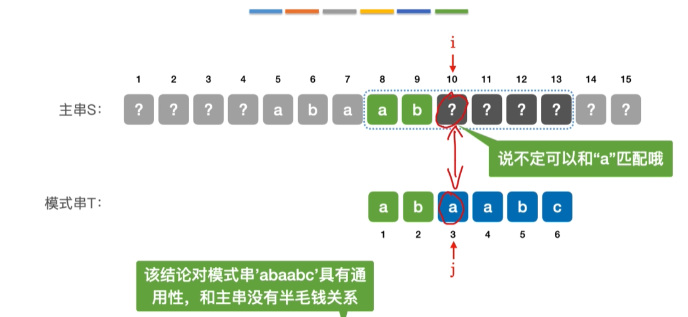

用next 数组记录模式串的 j


```C++
int Index_KMP(SString S,SString T,int next[]){
    int i=1,j=1;
    while(i<=S.length&&j<=T.length){
        if(j==0||S.ch[i]==T.ch[j]){
            ++i;
            ++j;
        }
        else
            j=next[j];//模式串向右移
    }
    if(j>T.length)
        return i-T.length;  //匹配成功
    else
        return 0; //匹配失败
}
```


## KMP算法 求next数组
### 求模式串的next数组
next 数组的作用：当模式串的第 j 个字符失配时，从模式串的第 next [j] 个字符继续匹配（next [j] 为 0 时主串和模式串指针各前进一位）


模式串 T = ababaa

next: 0 1 1 2 3 4

# 第五章 树与二叉树
## 树 定义 基本术语
### 树的基本概念


树是\(n（n\ge0）\)个结点的有限集合，\(n = 0\)时，称为空树，这是一种特殊情况。在任意一棵非空树中应满足：
1）有且仅有一个特定的称为根的结点。
2）当\(n > 1\)时，其余结点可分为\(m（m > 0）\)个互不相交的有限集合\(T_1,T_2,...,T_m\)，其中每个集合本身又是一棵树，并且称为根结点的子树。

### 树形逻辑结构的应用


### 节点之间的描述关系


### 节点、树的属性描述


### 有序树和无序树
有序树--逻辑上看，树中各节点的各子树从左至右是有次序的，不能互换
无序树--逻辑上看，树中各节点的各子树从左至右是无次序的，可以互换


### 树 VS 森林
森林。森林是m（m>=0）棵互不相交的树的集合


## 树  常考性质
### 树的常考性质

常见考点1：结点数=总度数+1
结点的度--结点有几个孩子（分支）

树的度--各节点度的最大值

m叉树--每个节点最多只能有m个孩子


常见考点3：度为m的树第i层至多有\(m^{i-1}\)个节点（i>=1）

常见考点4：高度为h的m叉树至多有\(\frac{m^h - 1}{m - 1}\)

常见考点5：具有$n$个结点的$m$叉树的最小高度为 $\left\lceil \log_m \big(n(m-1)+1\big) \right\rceil$

## 二叉树 定义 基本术语
### 二叉树的基本概念
二叉树是n（\(n\ge0\)）个结点的有限集合：
1 或者为空二叉树，即\(n = 0\)。
2 或者由一个根结点和两个互不相交的被称为根的左子树和右子树组成。左子树和右子树又分别是一棵二叉树。

特点：1，每个结点至多只有两棵子树 2，左右子树不能颠倒（二叉树是有序树）

### 二叉树的五种状态


### 几个特殊的二叉树

1，满二叉树

满二叉树：一棵高度为 h，且含有 \(2^h-1\) 个结点的二叉树

特点：
①只有最后一层有叶子结点
②不存在度为 1 的结点
③按层序从 1 开始编号，结点 i 的左孩子为 2i，右孩子为 \(2i+1\)；结点 i 的父节点为 \(\lfloor i/2 \rfloor\)（如果有的话）

2，完全二叉树

完全二叉树：当且仅当其每个结点都与高度为 h 的满二叉树中编号为 \(1\sim n\) 的结点一一对应时，称为完全二叉树

特点：
①只有最后两层可能有叶子结点
②最多只有一个度为 1 的结点
③按层序从 1 开始编号，结点 i 的左孩子为 2i，右孩子为 \(2i+1\)；结点 i 的父节点为 \(\lfloor i/2 \rfloor\)（如果有的话）
④ \(i\le \lfloor n/2 \rfloor\) 为分支结点，\(i> \lfloor n/2 \rfloor\) 为叶子结点

3，二叉排序树
二叉排序树：一棵二叉树或者是空二叉树，或者是具有如下性质的二叉树：
左子树上所有结点的关键字均小于根结点的关键字；
右子树上所有结点的关键字均大于根结点的关键字。
左子树和右子树又各是一棵二叉排序树。

4，平衡二叉树
平衡二叉树：树上任一结点的左子树和右子树的深度之差不超过1。

## 二叉树 常考性质
### 二叉树的常考性质
常见考点 1：设非空二叉树中度为 0、1 和 2 的结点个数分别为\(n_0\)、\(n_1\)和\(n_2\)，则\(\boldsymbol{n_0=n_2+1}\)
（叶子结点比二分支结点多一个）

假设树中结点总数为 n，则
① \(\boldsymbol{n = n_0 + n_1 + n_2}\)
② \(\boldsymbol{n = n_1 + 2n_2 + 1}\)


### 完全二叉树的性质

常见考点 1：具有 n 个（\(n>0\)）结点的完全二叉树的高度 h 为 \(\lceil \log_2(n + 1) \rceil\) 或 \(\lfloor \log_2 n \rfloor + 1\)

高度为 \(h-1\) 的满二叉树共有 \(\boldsymbol{2^{h-1}-1}\) 个结点


## 二叉树 存储结构
### 二叉树的顺序存储
```C++
#define MaxSize 100
struct TreeNode {
    ElemType value;//节点中的数据元素
    bool isEmpty;//节点是否为空
}

//定义

TreeNode t[MaxSize];
```
定义一个长度为MaxSize的数组t,按照从上至下，从左至右的顺序依次存储完全二叉树中的各个节点
```C++
//遍历
for (int i =0;i<Maxsize;i++){
    t[i].isEmpty=true;
}
```


### 二叉树的链式存储
```C++
typedef struct BiTNode{
    ElemType data; //数据域
    struct BiTNode *lchild,*rchild;
}BiTNode,*BiTree;
```
n 个结点的二叉链表共有 \(\boldsymbol{n+1}\) 个空链域
```C++
struct ElemType {
    int value;
};

struct BiTNode {
    ElemType data;
    BiTNode *lchild, *rchild;
};
using BiTree = BiTNode*;

// 定义一棵空树
BiTree root = nullptr;

// 插入根节点
root = new BiTNode;
root->data = {1};
root->lchild = nullptr;
root->rchild = nullptr;

// 插入新结点
BiTNode *p = new BiTNode;
p->data = {2};
p->lchild = nullptr;
p->rchild = nullptr;
root->lchild = p;    // 作为根节点的左孩子

```
## 二叉树 先/中/后序遍历

### 二叉树的遍历

```C++
void PreOrder(BiTree T){
    if(T!=nullptr){
        visit(T);
        PreOrder(T->lchild);
        PreOrder(T->rchild);
    }
}
```
详尽遍历代码参考C++算法文件


## 二叉树 层序遍历
### 二叉树的层序遍历


代码实现
```C++
    void LevelOrder(BiTree T){
        LinkQueue Q;
        InitQueue(Q);
        BiTree p;
        EnQueue(Q,T);
        while(!IsEmpty(Q)){
            DeQueue(Q,p);
            visit(p);
            if(p->lchild!=nullptr)
                EnQueue(Q,p->nextlchild);
            if(p->rchild!=nullptr)
                EnQueue(Q,p->rchild);
        }
    }

```
