本文档用于存储已经独立解过的算法题


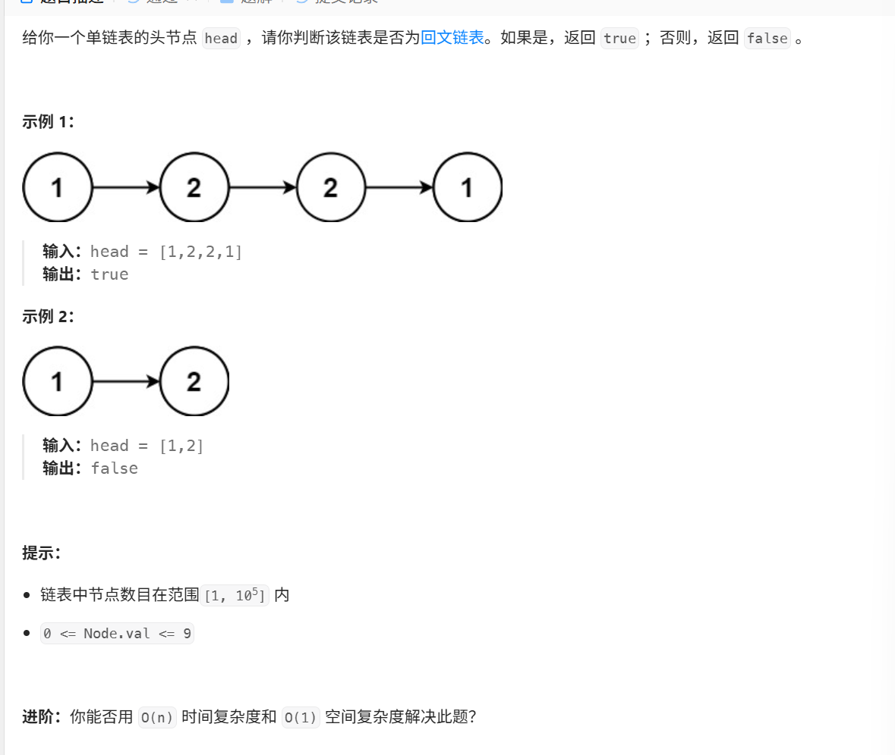

```C++
class Solution {
public:
    bool isPalindrome(ListNode* head) {
        ListNode *p =head;
        vector<int> vec1; //动态数组，用于存储链表元素
        while(p!=nullptr){
            vec1.push_back(p->val);
            p=p->next;
            
        }
        for(int i =0,j= vec1.size()-1;i<=j;i++,j--){
            if(vec1[i]!=vec1[j])
                return false;
        }
        return true;
    }
};
```

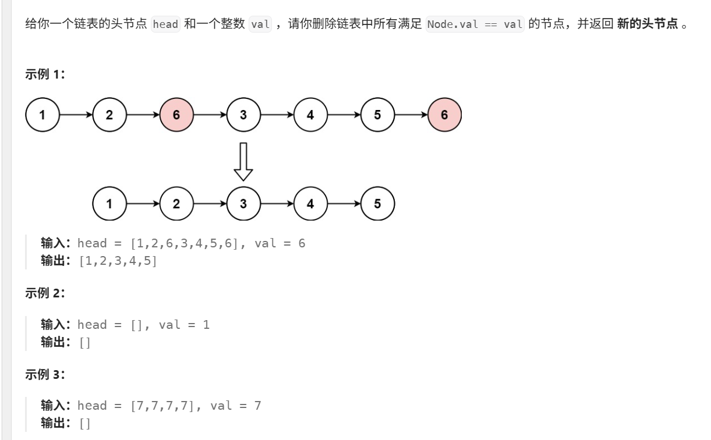

```C++
class Solution {
public:
    ListNode* removeElements(ListNode* head, int val) {

        ListNode dummy(0,head);
        ListNode * p=&dummy; //虚拟节点
        while(p->next!=nullptr){
            if(p->next->val==val){
                ListNode *q = p->next;
                p->next=q->next;
                delete q;
            }
            else
            {
                p=p->next;
            }
        }
        return dummy.next;
    }
};
```

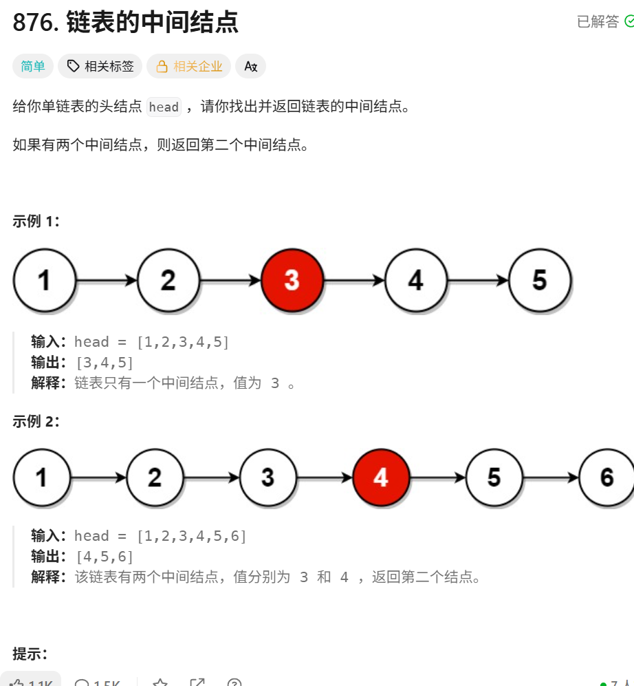

```C++
/**
 * Definition for singly-linked list.
 * struct ListNode {
 *     int val;
 *     ListNode *next;
 *     ListNode() : val(0), next(nullptr) {}
 *     ListNode(int x) : val(x), next(nullptr) {}
 *     ListNode(int x, ListNode *next) : val(x), next(next) {}
 * };
 */
class Solution {
public:
    ListNode* middleNode(ListNode* head) {
        ListNode *fast=head;
        ListNode *slow =head;
        while(fast!=nullptr && fast->next !=nullptr){
            fast=fast->next->next;
            slow=slow->next; 
        } 

        return slow;
    }
};
```
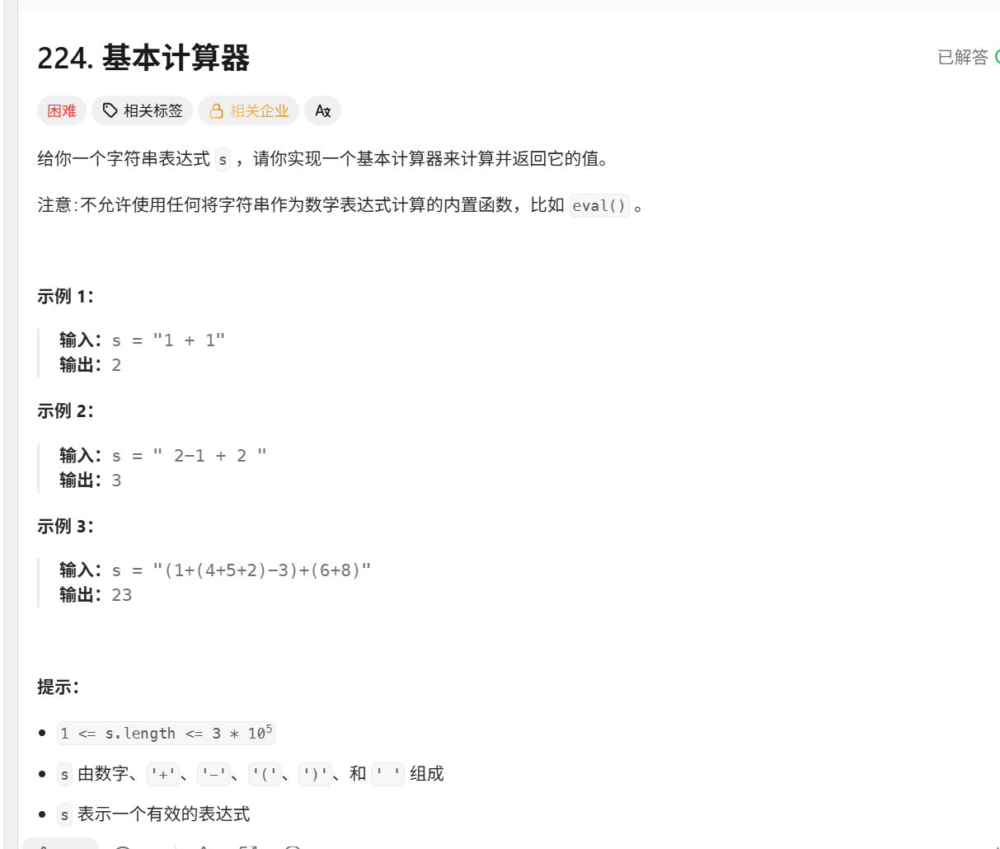
```C++
class Solution {
public:
    int calculate(string s) {
        stack<int> stk;
        int res =0;
        int sign =1;
      
        for(int i =0;i<s.size();i++){
            if(isdigit(s[i])){
                long long num =0;
                while(i<s.size()&& isdigit(s[i])){
                    num = num * 10 + (s[i] - '0');
                    i++;
                }
                res=res+num*sign;
                i--;
            }
            else if(s[i]=='+'){
                sign = 1;
            }
            else if(s[i]=='-'){
                sign = -1;
            }
            else if (s[i]=='('){
                stk.push(res);
                stk.push(sign);

                res =0;
                sign =1;
            }
            else if (s[i]== ')'){
                
                 int oldsign =stk.top();
                stk.pop();

                
                int oldres =stk.top();
                stk.pop();

                res=oldres+res*oldsign;
            }
        }
        return res;
    }
};
```
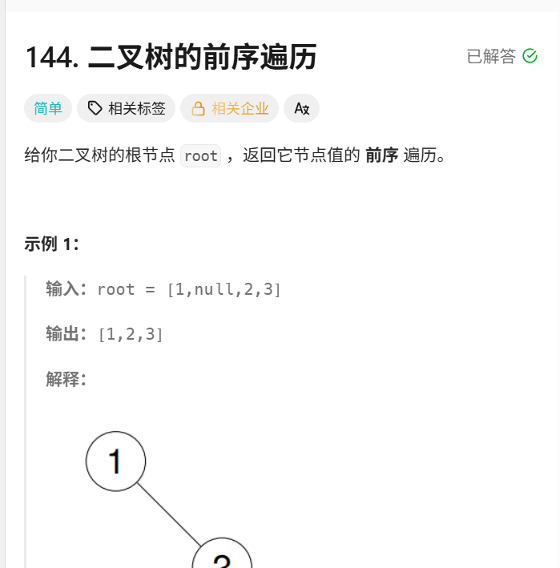
```c++
/**
 * Definition for a binary tree node.
 * struct TreeNode {
 *     int val;
 *     TreeNode *left;
 *     TreeNode *right;
 *     TreeNode() : val(0), left(nullptr), right(nullptr) {}
 *     TreeNode(int x) : val(x), left(nullptr), right(nullptr) {}
 *     TreeNode(int x, TreeNode *left, TreeNode *right) : val(x), left(left), right(right) {}
 * };
 */
class Solution {
public:

    void dfs(TreeNode *root,vector<int> &vec){
        if(root!=nullptr){
            vec.push_back(root->val);
            dfs(root->left,vec);
            dfs(root->right,vec);
        }
    }

    vector<int> preorderTraversal(TreeNode* root) {
        vector<int> vec;
        dfs(root,vec);
        return vec;
    }
};
```
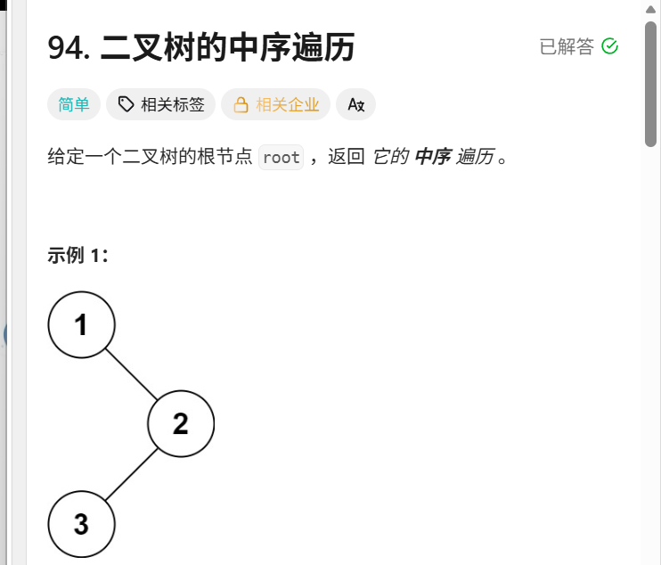
```C++
/**
 * Definition for a binary tree node.
 * struct TreeNode {
 *     int val;
 *     TreeNode *left;
 *     TreeNode *right;
 *     TreeNode() : val(0), left(nullptr), right(nullptr) {}
 *     TreeNode(int x) : val(x), left(nullptr), right(nullptr) {}
 *     TreeNode(int x, TreeNode *left, TreeNode *right) : val(x), left(left), right(right) {}
 * };
 */
class Solution {
public:
    void dfs(TreeNode * root,vector<int> &vec){
        if(root!=nullptr){
            dfs(root->left,vec);
            vec.push_back(root->val);
            dfs(root->right,vec);
        }
    }

    vector<int> inorderTraversal(TreeNode* root) {
        vector<int> vec;
        dfs(root,vec);
        return vec;
    }
};
```
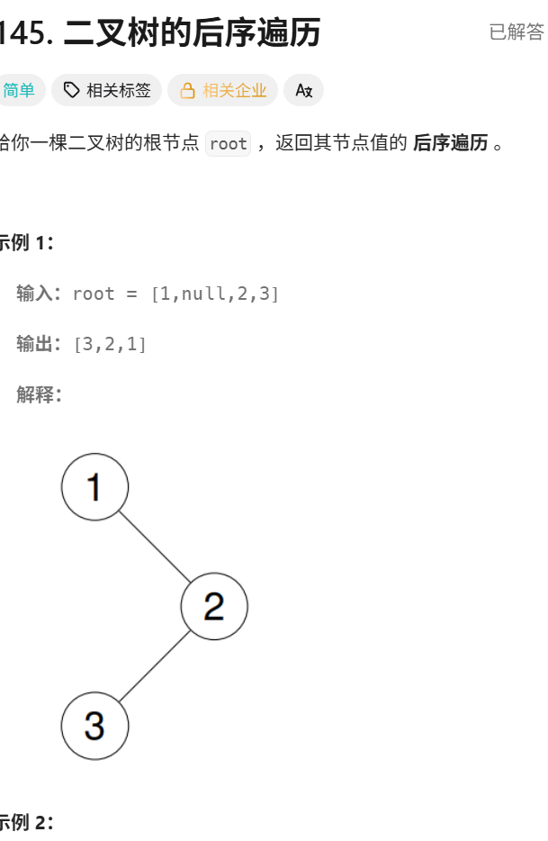
```C++
/**
 * Definition for a binary tree node.
 * struct TreeNode {
 *     int val;
 *     TreeNode *left;
 *     TreeNode *right;
 *     TreeNode() : val(0), left(nullptr), right(nullptr) {}
 *     TreeNode(int x) : val(x), left(nullptr), right(nullptr) {}
 *     TreeNode(int x, TreeNode *left, TreeNode *right) : val(x), left(left), right(right) {}
 * };
 */
class Solution {
public:
    void dfs(TreeNode * root,vector<int> &vec){
        if(root!=nullptr){
           
            dfs(root->left,vec);
            dfs(root->right,vec);
            
            vec.push_back(root->val);
        }
    }

    vector<int> postorderTraversal(TreeNode* root) {
        vector<int> vec;
        dfs(root,vec);
        return vec;
    }
};
```
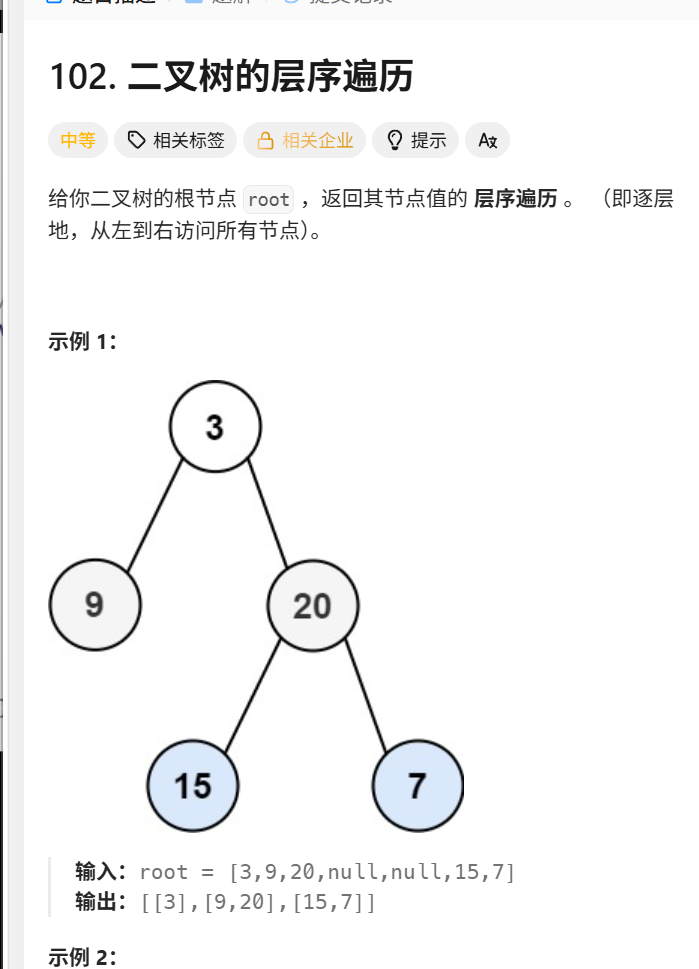
```C++
vector<vector<int>> levelOrder(TreeNode* root) {
        queue<TreeNode*> q;
        vector<vector<int>> res;
        if (root == nullptr) return res;

        q.push(root);
        while(!q.empty()){

            int size =q.size();
            vector<int> vec;
            for(int i=0;i<size;i++){
            TreeNode* p = q.front();
            q.pop();
            vec.push_back(p->val);
           
            if(p->left)
                q.push(p->left);
            if(p->right)
                q.push(p->right);
            }
            res.push_back(vec);
        }
        return res;
    }
```
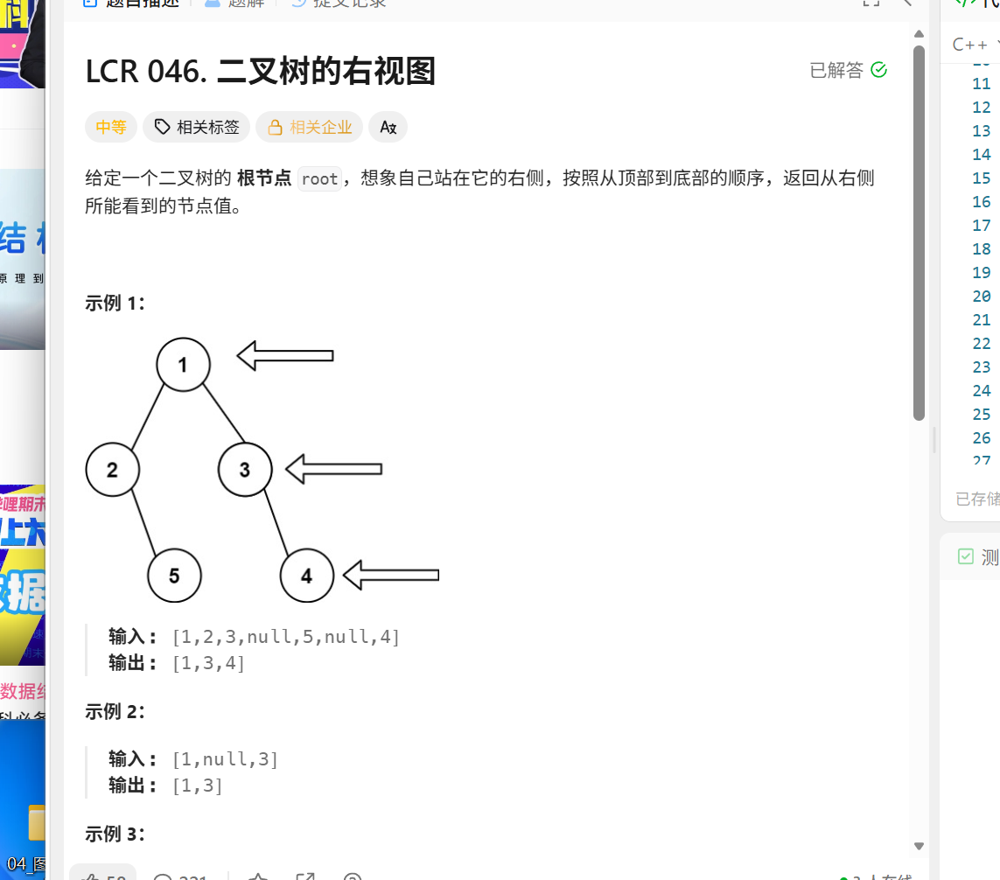
```C++
class Solution {
public:
    vector<int> rightSideView(TreeNode* root) {
        queue<TreeNode*> q;
        vector<int> res;
        if(root ==nullptr) return res;
        q.push(root);
        while(!q.empty()){
            int size =q.size();
            for(int i = 0;i<size;i++){
                TreeNode *p=q.front();
                q.pop();
                if(i==size-1)
                    res.push_back(p->val);
                if(p->left)
                    q.push(p->left);
                if(p->right)
                    q.push(p->right);
            }
        }
        return res;
    }
};
```
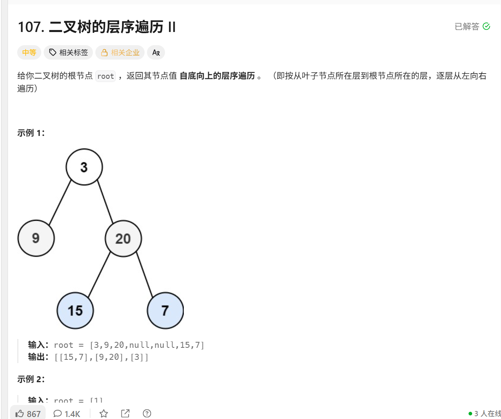
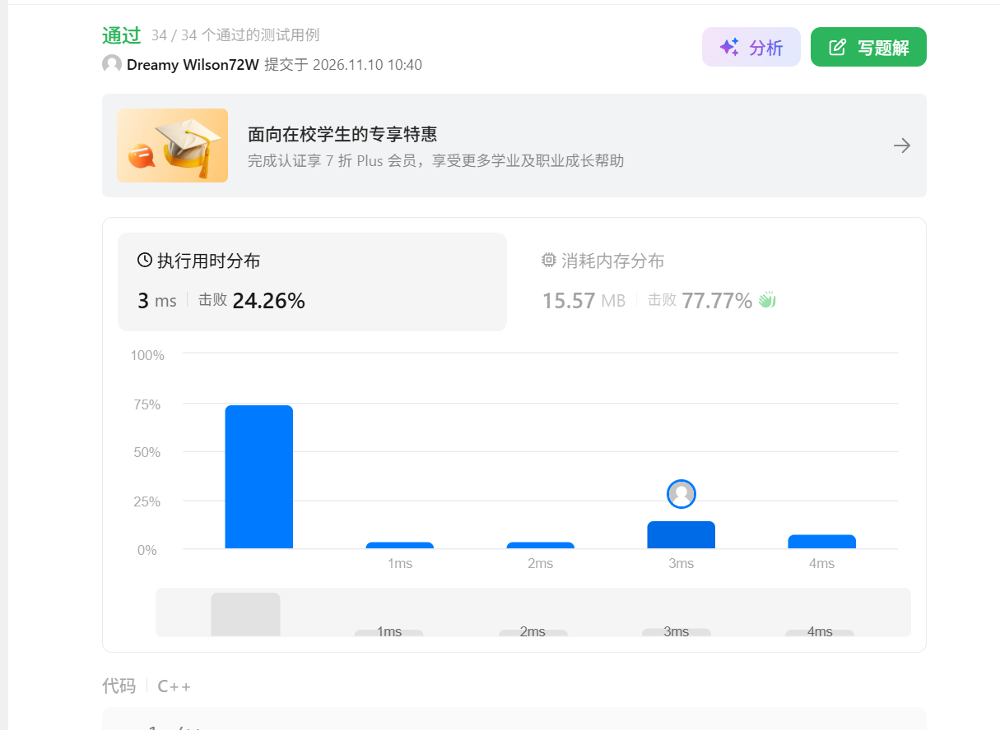

```C++
/**
 * Definition for a binary tree node.
 * struct TreeNode {
 *     int val;
 *     TreeNode *left;
 *     TreeNode *right;
 *     TreeNode() : val(0), left(nullptr), right(nullptr) {}
 *     TreeNode(int x) : val(x), left(nullptr), right(nullptr) {}
 *     TreeNode(int x, TreeNode *left, TreeNode *right) : val(x), left(left), right(right) {}
 * };
 */
class Solution {
public:
    vector<vector<int>> levelOrderBottom(TreeNode* root) {
        vector<vector<int>> res;
        queue<TreeNode *> q;
        if(root == nullptr) return res; 
        q.push(root);
        while(!q.empty()){
            int size =q.size();
            vector<int> vec;
            for(int i=0;i<size;i++){
                TreeNode *p=q.front();
                q.pop();
                vec.push_back(p->val);

                if(p->left)
                q.push(p->left);
                if(p->right)
                q.push(p->right);
            }
                res.push_back(vec);
            }
            reverse(res.begin(),res.end());
            return res;
        }
        
    
};
```
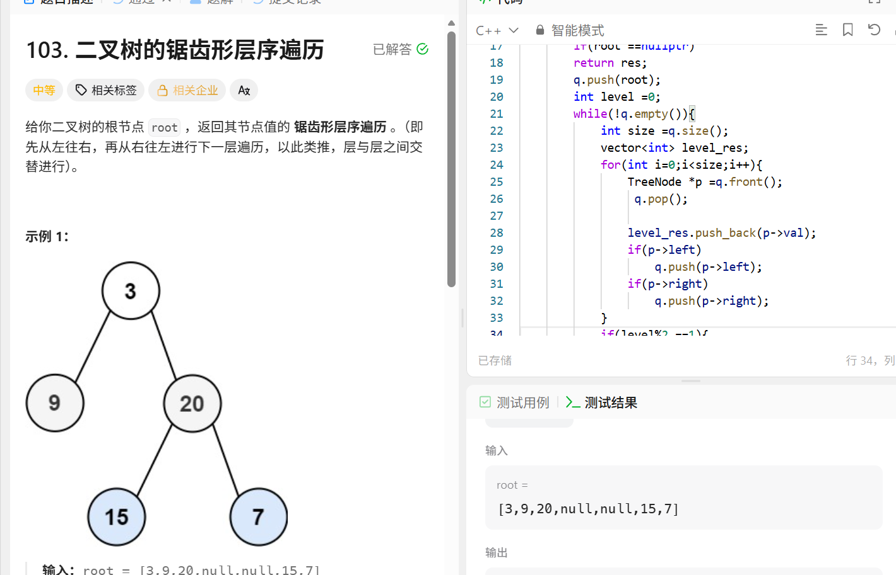
```C++
/**
 * Definition for a binary tree node.
 * struct TreeNode {
 *     int val;
 *     TreeNode *left;
 *     TreeNode *right;
 *     TreeNode() : val(0), left(nullptr), right(nullptr) {}
 *     TreeNode(int x) : val(x), left(nullptr), right(nullptr) {}
 *     TreeNode(int x, TreeNode *left, TreeNode *right) : val(x), left(left), right(right) {}
 * };
 */
class Solution {
public:
    vector<vector<int>> zigzagLevelOrder(TreeNode* root) {
        queue<TreeNode *> q;
        vector<vector<int>> res;
        if(root ==nullptr)
        return res;
        q.push(root);
        int level =0;
        while(!q.empty()){
            int size =q.size();
            vector<int> level_res;
            for(int i=0;i<size;i++){
                TreeNode *p =q.front();
                 q.pop();
                
                level_res.push_back(p->val);
                if(p->left)
                    q.push(p->left);
                if(p->right)
                    q.push(p->right);
            }
            if(level%2 ==1){
                reverse(level_res.begin(), level_res.end());
            }
            res.push_back(level_res);
            level++;
        }
        return res;
    }
};
```