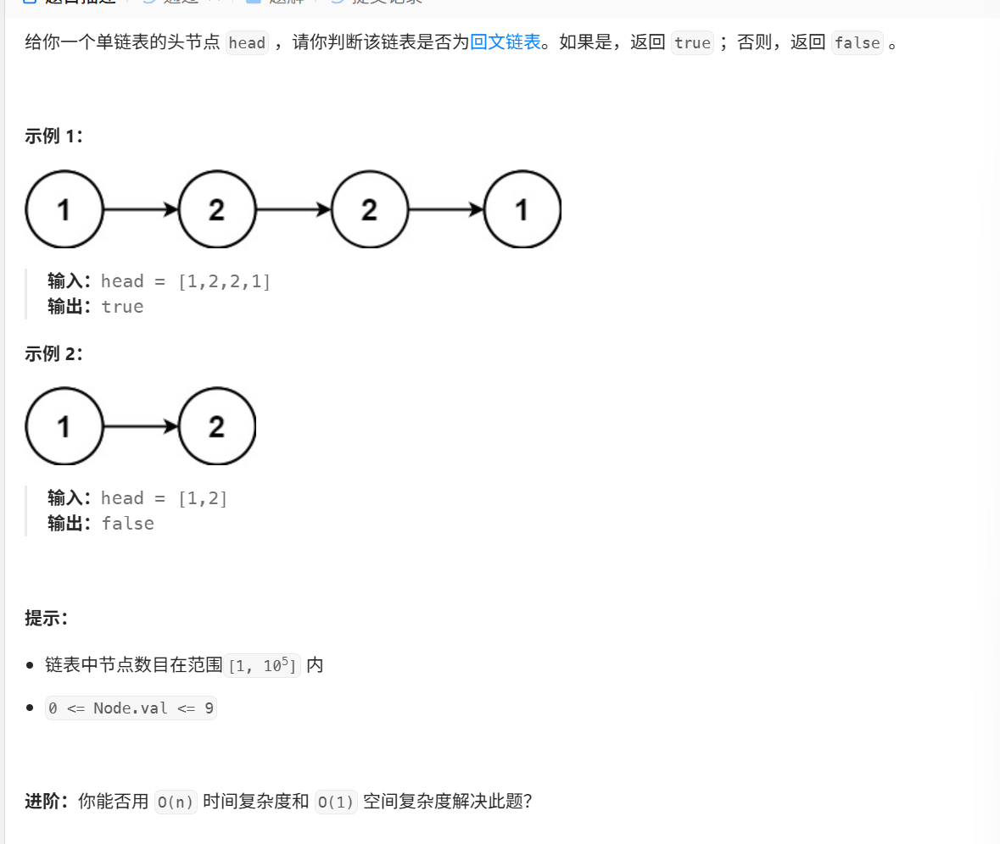
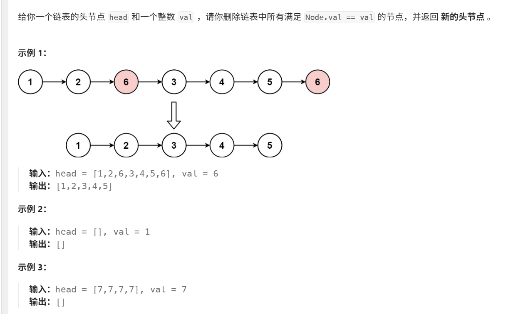
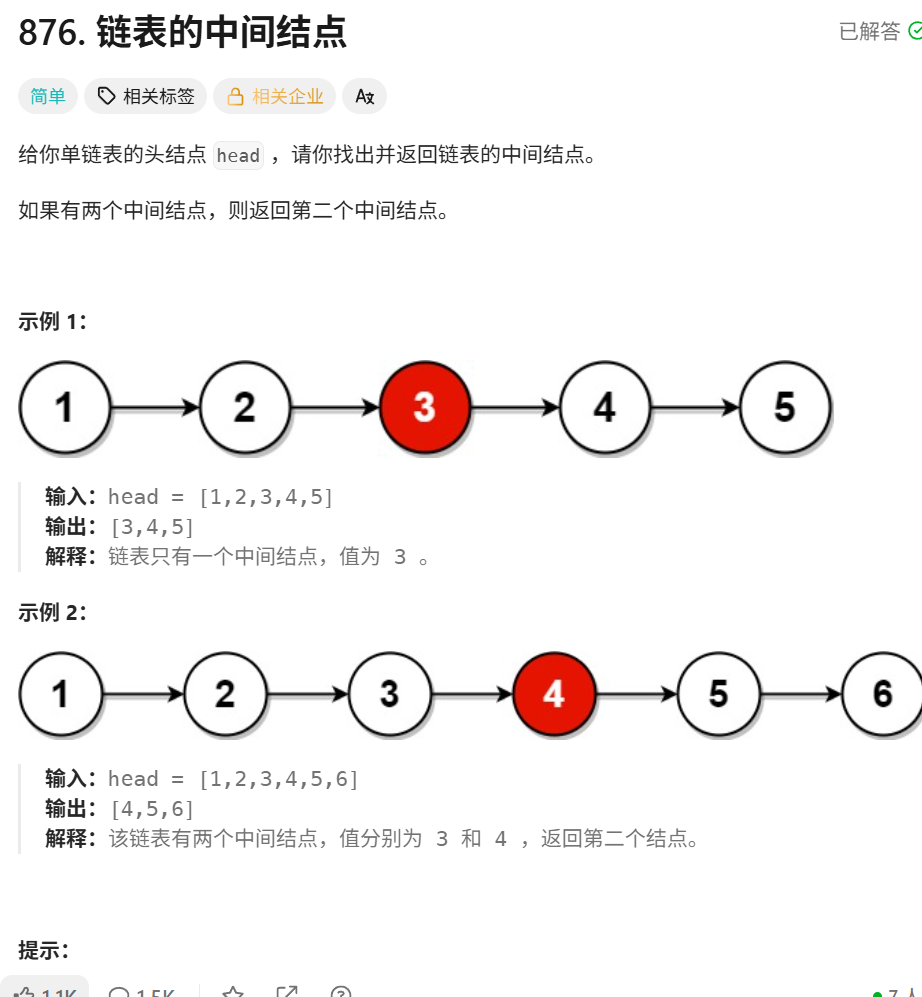

本文档用于存储已经独立解过的算法题




```C++
class Solution {
public:
    bool isPalindrome(ListNode* head) {
        ListNode *p =head;
        vector<int> vec1; //动态数组，用于存储链表元素
        while(p!=nullptr){
            vec1.push_back(p->val);
            p=p->next;
            
        }
        for(int i =0,j= vec1.size()-1;i<=j;i++,j--){
            if(vec1[i]!=vec1[j])
                return false;
        }
        return true;
    }
};
```



```C++
class Solution {
public:
    ListNode* removeElements(ListNode* head, int val) {

        ListNode dummy(0,head);
        ListNode * p=&dummy; //虚拟节点
        while(p->next!=nullptr){
            if(p->next->val==val){
                ListNode *q = p->next;
                p->next=q->next;
                delete q;
            }
            else
            {
                p=p->next;
            }
        }
        return dummy.next;
    }
};
```



```C++
/**
 * Definition for singly-linked list.
 * struct ListNode {
 *     int val;
 *     ListNode *next;
 *     ListNode() : val(0), next(nullptr) {}
 *     ListNode(int x) : val(x), next(nullptr) {}
 *     ListNode(int x, ListNode *next) : val(x), next(next) {}
 * };
 */
class Solution {
public:
    ListNode* middleNode(ListNode* head) {
        ListNode *fast=head;
        ListNode *slow =head;
        while(fast!=nullptr && fast->next !=nullptr){
            fast=fast->next->next;
            slow=slow->next; 
        } 

        return slow;
    }
};
```