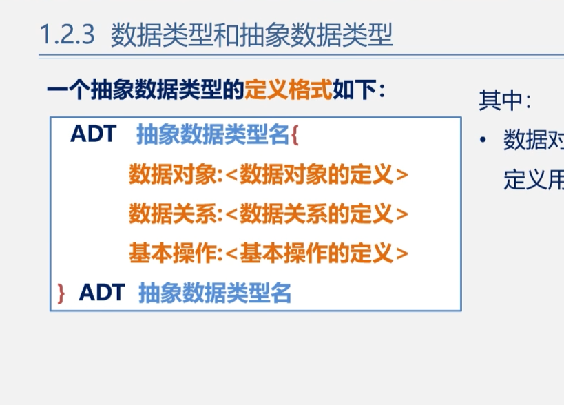
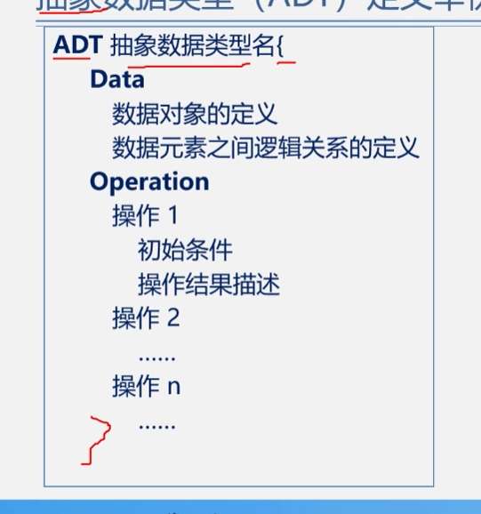
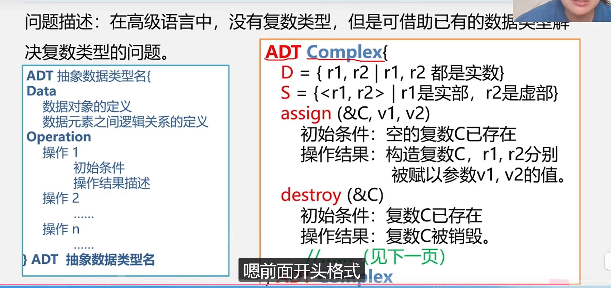
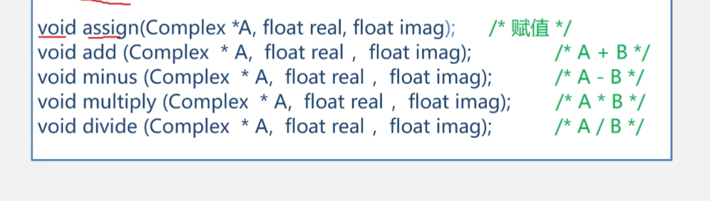
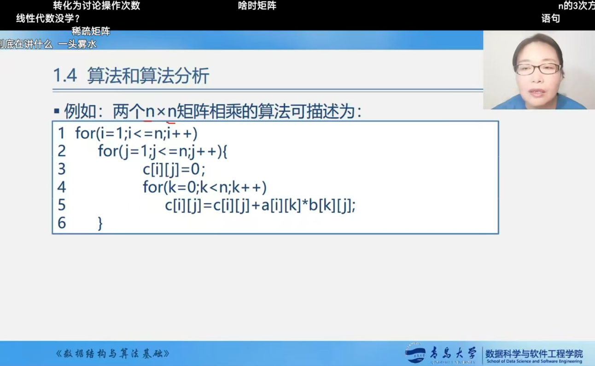

# 数据结构学习笔记

> **以后怎样做笔记：**先理解，再用自己的话总结。每个知识点按“定义 → 特点 → 例子 → 易错点”记录；课堂上抓重点，课后及时补齐，用题目或代码检验理解。

## 笔记方法提醒

1. **统一层级：**一级标题写笔记名称，二级标题写章节，三级标题写知识点；不要用缩进代替正文排版。
2. **突出重点：**定义准确、例子具体，关键术语适当加粗，避免整段加粗。
3. **规范代码：**C 代码使用标注 `c` 的代码块，伪代码使用 `text`；检查拼写、分号和边界条件。
4. **图片配文字：**截图作为参考，关键结论也写成文字；移动笔记时一起移动图片。
5. **记录疑问：**用“待确认”标记不懂的内容，查清后补上答案，不把猜测当结论。
6. **及时复习：**每章留几道自测题，合上笔记回答；答不出来的知识点再补例子。

---

## 一、数据结构的基本概念

### 1. 逻辑结构

**逻辑结构**描述数据元素之间的逻辑关系，与具体存储方式无关。

| 类别 | 特点 | 例子 |
| --- | --- | --- |
| 线性结构 | 非空时有唯一的开始元素和终端元素；除开始元素外，每个元素有唯一的直接前驱；除终端元素外，每个元素有唯一的直接后继 | 线性表、栈、队列、串 |
| 非线性结构 | 不满足上述线性关系，元素之间可能存在一对多或多对多的关系 | 树、图 |

按关系形式，常见的四种基本逻辑结构为：

1. **集合结构：**元素之间只有“同属于一个集合”的关系。
2. **线性结构：**元素之间存在一对一的关系。
3. **树形结构：**元素之间存在一对多的关系。
4. **图状结构：**元素之间存在多对多的关系。

> **易错点：**线性结构的开始元素没有直接前驱，终端元素没有直接后继，不能说所有元素都有一个前驱和一个后继。

### 2. 存储结构

**存储结构**也称物理结构，是数据及其逻辑关系在计算机中的表示。

| 存储方式 | 核心思想 | 说明 |
| --- | --- | --- |
| 顺序存储 | 使用连续的存储单元依次存储数据元素，用存储位置表示逻辑关系 | C 语言中通常使用数组实现 |
| 链式存储 | 使用不要求连续的存储单元存储数据元素，用指针等链接信息表示逻辑关系 | C 语言中通常使用结构体和指针实现 |
| 索引存储 | 存储数据的同时建立索引表，通过索引查找数据 | 索引项通常包含关键字和存储位置等信息 |
| 散列存储 | 根据关键字，通过散列函数计算存储位置 | 不同关键字可能产生相同地址，需要处理冲突 |

顺序存储示意：

```text
[bat][cat][eat]…
```

> **记忆要点：**逻辑结构回答“元素之间是什么关系”，存储结构回答“元素及关系怎样存到计算机中”。同一种逻辑结构可以采用不同的存储结构。
>
> **原笔记中的疑问——区块链：**区块链中的区块通过密码学哈希等机制关联，但它不等同于这里用指针连接结点的链式存储结构。

### 3. 数据类型

**数据类型**是一组性质相同的值的集合，以及定义在这个值集合上的一组操作的总称。

```text
数据类型 = 值的集合 + 定义在值集合上的操作
```

声明变量的数据类型，会约束它能表示的值及可进行的操作。

C 语言中的常见类型与相关概念：

- **基本类型：**如 `int`、`char`、`float`、`double`。
- **其他常见类型：**数组、结构体（`struct`）、联合体（`union`，也称共用体）、枚举（`enum`）、指针类型等。
- **`void`：**表示无值，例如函数不返回值时使用；`void *` 可作为通用对象指针类型。
- **`typedef`：**为已有类型定义别名，本身不是一种数据类型。

> **易错点：**复杂数据结构可以用已有类型组合表示和实现，例如用结构体与指针实现链表。不能说“复杂数据结构不能用数据类型表示”。

### 4. 抽象数据类型（ADT）

**抽象数据类型**（Abstract Data Type，ADT）是一个数学模型，以及定义在这个模型上的一组操作。它关注数据及操作的含义，不规定具体的存储方式和实现细节。

ADT 通常用三元组表示：

```text
ADT = (D, S, P)
D：数据对象
S：D 上的关系集合
P：对 D 的基本操作集合
```

形式定义的一般写法：

```text
ADT 类型名 {
    数据对象：描述数据对象
    数据关系：描述数据元素之间的关系
    基本操作：描述各项操作
} ADT 类型名
```

数据对象、数据关系和基本操作通常使用数学表达式、文字或伪代码描述。



### 5. 基本操作的描述

| 项目 | 含义 |
| --- | --- |
| 操作名与参数表 | 说明操作名称、输入以及需要返回或修改的数据 |
| 初始条件 | 执行前数据结构和参数必须满足的条件；没有要求时可省略 |
| 操作结果 | 说明执行后的返回结果或数据状态变化 |

教材伪代码中的参数常分为：

- **值参数（赋值参数）：**为操作提供输入值，如 `Area(C)` 中的 `C`。
- **引用参数：**除提供输入外，还可返回结果或修改对象，常以 `&` 标记，如 `Circle(&C, r, x, y)` 中的 `C`。

> **易错点：**这里的 `&C` 是教材伪代码的表示约定。C 语言没有 C++ 那样的引用参数；C 中要修改调用者的对象，通常传入对象地址，通过指针操作。

### 6. ADT 示例：圆（Circle）

用半径和圆心坐标描述一个圆，并定义创建、求面积和求周长的操作。

```text
ADT Circle {
    数据对象：
        D = { (r, x, y) | r、x、y 为实数，且 r > 0 }
    数据关系：
        r 表示半径，(x, y) 表示圆心坐标
    基本操作：
        Circle(&C, r, x, y)
            初始条件：r > 0
            操作结果：构造半径为 r、圆心为 (x, y) 的圆 C
        Area(C)
            初始条件：圆 C 已存在
            操作结果：返回圆的面积 πr²
        Circumference(C)
            初始条件：圆 C 已存在
            操作结果：返回圆的周长 2πr
} ADT Circle
```

本例约定半径大于零；如果允许退化圆，也可以约定半径大于或等于零，但定义与操作条件要一致。



### 7. ADT 的表示与实现：复数示例

在 C 语言中实现 ADT，一般分为两步：

1. 用已有类型描述其存储结构。
2. 用函数实现其基本操作。

复数 `z = a + bi` 可以用实部 `a` 和虚部 `b` 表示。



C 语言存储结构示例：

```c
typedef struct {
    float realpart;
    float imagpart;
} Complex;
```

复数加法的实现示例（整理时补充）：

```c
Complex AddComplex(Complex a, Complex b) {
    Complex result;
    result.realpart = a.realpart + b.realpart;
    result.imagpart = a.imagpart + b.imagpart;
    return result;
}
```



> **记忆要点：**ADT 规定“数据是什么、能做哪些操作”，具体实现决定“用什么类型存、用什么代码操作”。

## 二、算法与算法分析

### 1. 算法的定义与描述

**算法**是对特定问题求解方法和步骤的描述，是指令的有限序列，其中每条指令表示一个或多个操作。

简而言之，算法是解决问题的方法和步骤。

常见描述方式：自然语言、流程图、伪代码。

**算法与程序：**算法描述求解思路和步骤；程序是用某种编程语言写成的指令集合，可以实现算法。同一个算法可以用不同语言实现。程序不一定具有算法要求的有穷性，例如持续运行的服务程序。

### 2. 算法的五个基本特性

| 特性 | 含义 |
| --- | --- |
| 有穷性 | 执行有限步骤后结束，每一步也能在有限时间内完成 |
| 确定性 | 每条指令含义明确，没有歧义 |
| 可行性 | 每个操作都能通过有限次基本操作实现 |
| 输入 | 有零个或多个输入 |
| 输出 | 有一个或多个输出 |

### 3. 算法的设计要求

- **正确性：**满足问题要求，对合法输入得到正确结果。
- **可读性：**结构清楚，便于理解和维护。
- **健壮性：**对非法输入或异常情况作出合理处理。
- **高效性：**时间开销合理，存储空间使用适当。

### 4. 算法效率的分析方法

算法分析主要关注**时间效率**和**空间效率**。

| 方法 | 做法 | 特点 |
| --- | --- | --- |
| 事后统计 | 实现并运行程序，测量时间和空间开销 | 结果受硬件、语言、编译器、测试数据等影响 |
| 事前分析 | 运行前根据算法结构，估算基本操作次数和所需空间 | 便于比较输入规模增长时的资源变化趋势 |

> **易错点：**“将算法实现后测算时间和空间开销”属于事后统计，不属于事前分析。

### 5. 时间复杂度

算法的实际运行时间可粗略理解为：

```text
运行时间 ≈ Σ（语句执行次数 × 该语句执行一次所需时间）
```

分析时通常采用简化模型：把选定的基本操作视为消耗单位时间，关注其执行次数随输入规模 `n` 的变化。

设基本操作次数为 `T(n)`，用 `O(f(n))` 表示其渐近上界，常简称时间复杂度。

如果存在正常数 `c` 和 `n₀`，使得对所有 `n ≥ n₀` 都有：

```text
0 ≤ T(n) ≤ c · f(n)
```

则可写为 `T(n) = O(f(n))`。

常见化简方法：忽略常数因子和低阶项，保留主导增长的项。例如：

```text
T(n) = 2n³ + 3n² + 2n + 1
T(n) = O(n³)
```

> **易错点：**把基本语句视为单位时间，不代表整个算法就是 `O(n)`；还要统计执行次数。
>
> **补充：**如果 `T(n) / f(n)` 趋于一个非零有限常数，则二者同阶，可更精确地记为 `T(n) = Θ(f(n))`。`O` 表示上界，`Θ` 表示紧确的增长阶。

### 6. 示例：两个 n × n 矩阵相乘

常规矩阵乘法的核心伪代码：

```text
for i = 0 to n - 1
    for j = 0 to n - 1
        C[i][j] = 0
        for k = 0 to n - 1
            C[i][j] = C[i][j] + A[i][k] * B[k][j]
```

最内层的乘加操作执行 `n × n × n = n³` 次，所以时间复杂度为 `O(n³)`。

原笔记记录的计数式为 `T(n) = 2n³ + 3n² + 2n + 1`。具体系数取决于语句计数方式，复习时重点理解三层循环为什么带来三次方增长。



### 7. 常见时间复杂度（整理时补充）

常见增长速度从慢到快排列：

```text
O(1) < O(log n) < O(n) < O(n log n) < O(n²) < O(n³) < O(2ⁿ) < O(n!)
```

| 复杂度 | 典型例子 |
| --- | --- |
| `O(1)` | 按下标访问数组元素 |
| `O(log n)` | 在有序数组上进行二分查找 |
| `O(n)` | 遍历 n 个元素 |
| `O(n²)` | 两层循环，各自执行 n 次 |
| `O(n³)` | 常规 n × n 矩阵乘法 |

> **注意：**不能只按循环层数判断复杂度，要看循环范围和变量变化方式。同样规模的输入也可能导致不同操作次数，应说明分析的是最好、最坏还是平均情况。

### 8. 空间复杂度（补全）

**空间复杂度**描述算法所需存储空间随输入规模增长的趋势，常记作 `S(n) = O(g(n))`。

分析时要明确是否计入输入和输出空间；题目通常关注算法使用的**辅助空间**。

- 固定数量的临时变量：辅助空间通常为 `O(1)`。
- 额外建立长度为 n 的数组：辅助空间为 `O(n)`。
- 额外建立 n × n 的矩阵：辅助空间为 `O(n²)`。
- 使用递归：还要考虑递归调用栈占用的空间。

以矩阵乘法为例，若结果矩阵 C 计入额外空间，则需要 `O(n²)`；若 C 已由调用者提供，且只统计运算过程的临时变量，则该过程的辅助空间为 `O(1)`。

