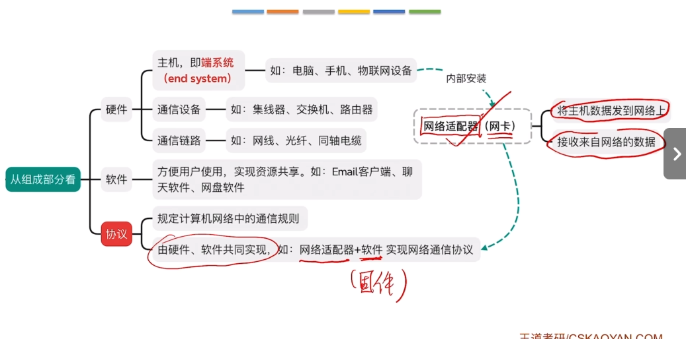
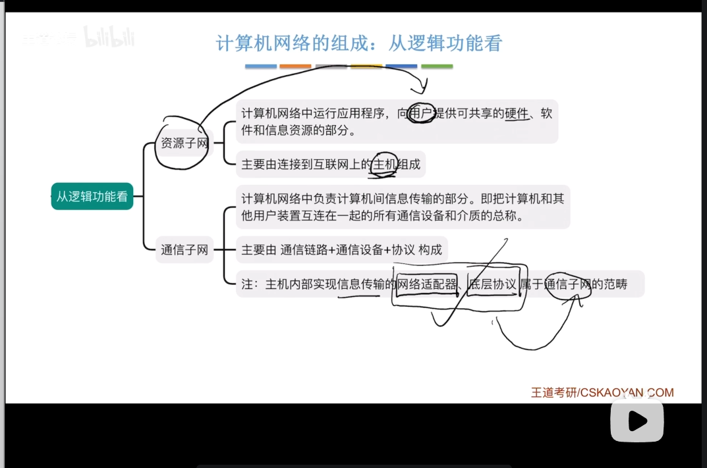
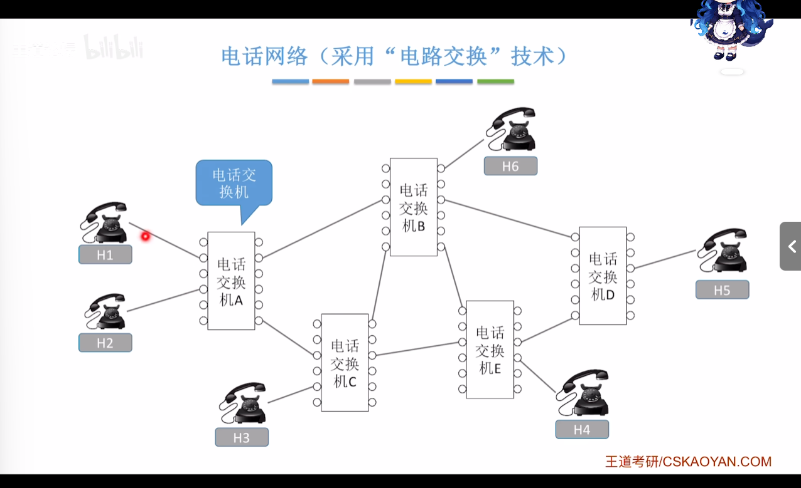
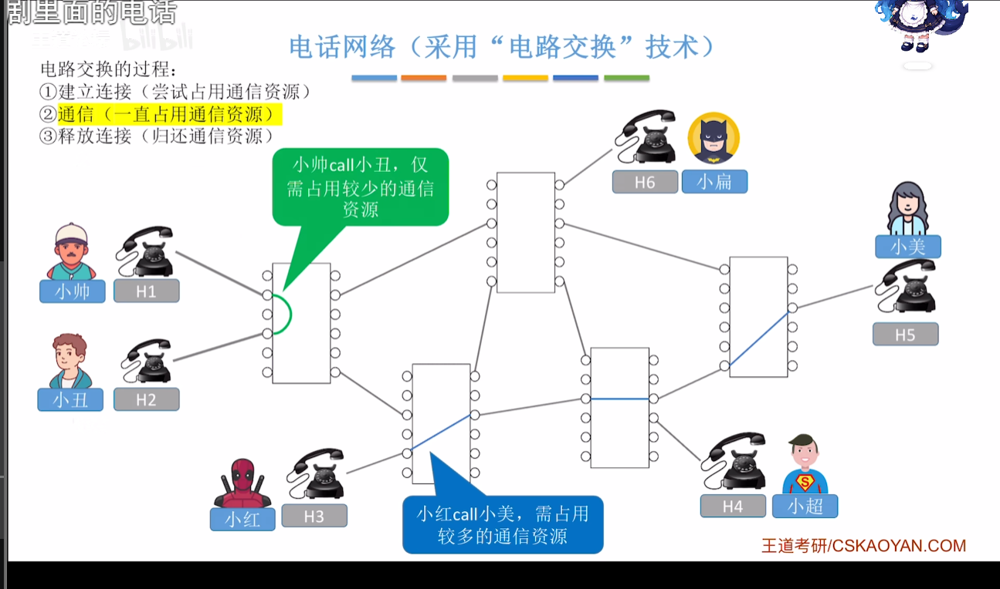
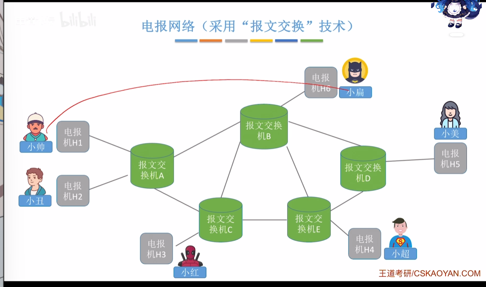
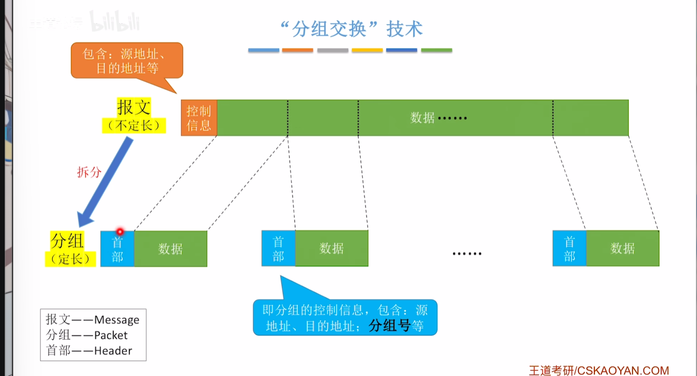

# 计算机网络体系结构
## 计算机网络的概念
### 什么是计算机网络

**计算机网络**是一个将众多分散的、自治的计算机系统，通过通信设备与线路连接起来，由功能完善的软件实现资源共享和信息传递的系统。

### 计算机网络、互连网、互联网的区别

**计算机网络**：由若干节点和连接这些节点的链路组成

    集线器：可以把多个节点连接起来，组成一个计算机网络
    交换机：可以把多个节点连接起来，组成一个计算机网络
**互连网**：

    路由器：可以把两个或者多个计算机网络互相连接起来，形成更大的计算机网络

**互联网**：由各大JSP和国际机构组建的，覆盖全球范围的互连网

    isp
    互联网必须使用TCP/IP协议通信，互连网可使用任意协议通信

## 计算机网络的组成、功能

### 网络适配器
我的网卡：Realtek 8852BE Wireless LAN WiFi 6 PCI-E NIC

### 计算机网络的功能
    1.数据通信
        最基本，最重要的功能
    2.资源共享
        硬件
        软件
        数据
    3.分布式处理
        将复杂任务分派给网络的多台计算机
    4.提高可靠性
    5.负载均衡
        网络中繁重任务让网络中的计算器共同承担
    6.其他

## 电路交换、报文交换、分组交换
### 计算机网络发展面临的初期问题

1960s ARPAnet
|邮政网络|电报网络|电话网络|研发计算机网络|
| ---- | ---- | ---- | ---- |
|公元前5世纪起|1930s~1960s|1870s~1960s|1960s|

### 电话网络（采用“电路交换”技术）
需要使用电话交换机

**电路交换的过程**：
    1，建立连接（尝试占用通信资源）
    2，通信（一致占用通信资源）
    3，释放链接（归还通信资源）

优点：通信前从主叫端到被叫端建立一条专用的物理通路，在通信的全部时间内，两个用户始终占用端到端的线路资源。数据直送，传输速率高

    适用于低频次，大量数据传输

计算机之间数据往往是“突发式”传输。即往往会高频次、少量地传输数据。    

缺点：
建立/释放链接需要额外时间开销
线路被通信双方独占，利用率低
线路的分配灵活性差
并不支持“差错控制”（无法发现传输过程中的数据错误）

### 电报网络 （采用“报文交换”技术）

发送一个报文需要

控制信息  用户数据

**存储转发**的思想：把传送的数据单元先存储进中间节点，再根据目的地址转发至下一节点

优点：
    
    通信前无需建立连接
    数据以“报文”为单位被交换节点间“存储转发”，通信线路可以灵活分配
    在通信时间内，两个用户无需独占一整条物理线路。

相比于电路交换，线路利用率高

交换节点支持“差错控制”（通过校验技术）
缺点：
    
    报文不定长，不方便存储转发管理
    长报文的存储转发时间开销大，缓存开销大
    长报文容易出错，重传代价高

### 分组交换技术

分组交换的优点:
    
    通信前无需建立连接
    数据以“分组”为单位被交换节点间“存储转发”，通信线路可以灵活分配
    在通信时间内，两个用户无需独占一整条物理线路。相比于电路交换，线路利用率高
交换节点支持“差错控制”(通过校验技术)

相比于报文交换，分组交换改进了如下问题:
    
    分组定长，方便存储转发管理
    分组的存储转发时间开销小、缓存开销小
    分组不易出错，重传代价低

分组交换的缺点
    
    相比于报文交换，控制信息占比增加
    相比于电路交换，依然存在存储转发时延
    报文被拆分为多个分组，传输过程中可能出现失序、丢失等问题，增加处理的复杂度